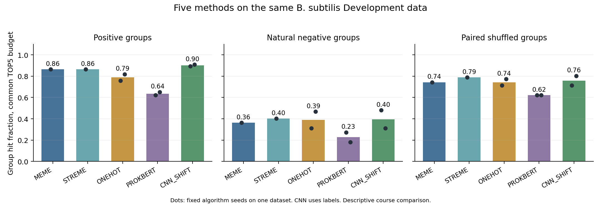
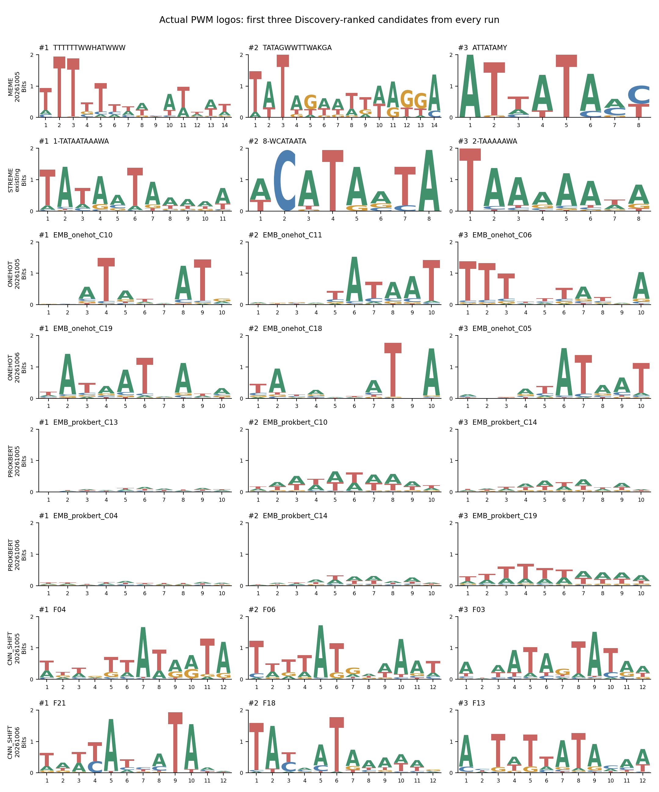
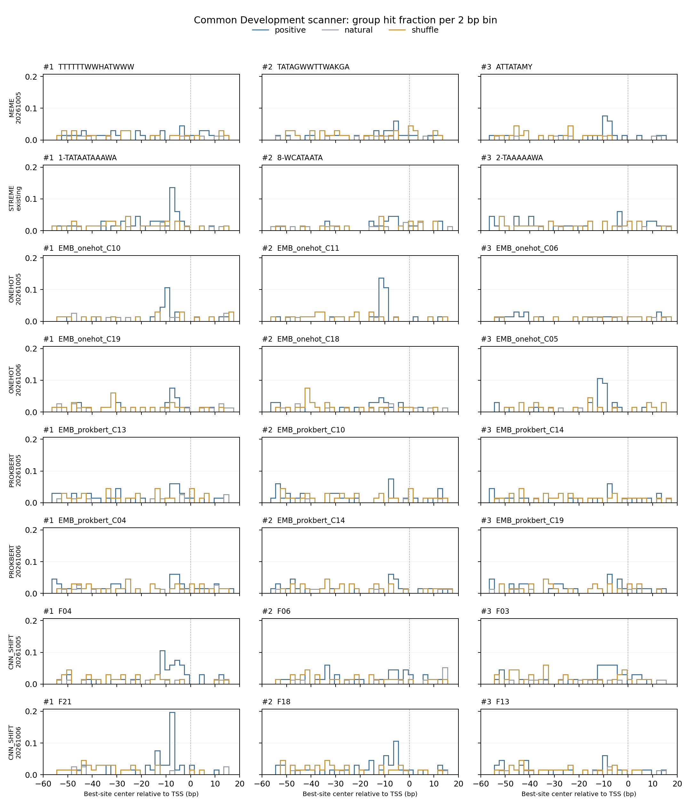

# 机器学习课程实验：同数据五方法候选展示

本轮以枯草芽孢杆菌为完整案例，补齐冻结 Discovery 上的 MEME 后，对 MEME、STREME、One-hot、ProkBERT 和 CNN 使用同一套评价程序。已有模型及历史结果保留，没有新增 BERT/CNN/One-hot 训练。

## 数据与横向对齐

逐方法输入哈希、学习条件、评价分区和候选预算见 [横向对齐验收表](alignment.tsv)。输入/评价口径一致，方法自身的训练方式保留。

| 分区 | 正类序列 | 天然负类序列 | 配对Shuffle序列 | 正类有效组 | 天然负类有效组 |
| --- | ---: | ---: | ---: | ---: | ---: |
| discovery | 473 | 559 | 473 | 464 | 559 |
| development | 67 | 77 | 67 | 66 | 77 |

输入为既有 v2、81 bp、TSS局部第61位。候选产生和共同阈值设定仅用 Discovery；Development 用于课程探索展示，未新增 Holdout 评价。各候选统一采用双链扫描、同一零阶背景和 Discovery 天然负类最大分数的90%分位阈值（higher，严格大于）。按 Discovery 正类减天然负类的同源组命中率排序，信息量和候选ID作为并列顺序。天然比较排除混标签组，Shuffle始终与正类配对。

TOP5用于等候选预算比较；ALL用于展示实际产出规模。单候选10%附近的校准比例不等于候选集合10%误报率，多候选合并可能增加对照命中。共同扫描分数与阈值不称作FIMO p/q，也不更改历史严格统计。

## 五方法比较

柱为既定运行均值，点为每次运行。MEME/STREME各1次固定运行，One-hot、BERT、CNN各2个既定种子；种子共享数据。CNN使用序列级标签监督，方法生成候选的过程和监督条件不同。

| 方法 | 种子 | 正类组命中 | 天然负类组命中 | 差值 | 配对Shuffle组命中 |
| --- | --- | ---: | ---: | ---: | ---: |
| MEME | 20261005 | 0.864 | 0.364 | +0.500 | 0.742 |
| STREME | existing | 0.864 | 0.403 | +0.461 | 0.788 |
| ONEHOT | 20261005 | 0.758 | 0.312 | +0.446 | 0.712 |
| ONEHOT | 20261006 | 0.818 | 0.468 | +0.351 | 0.773 |
| PROKBERT | 20261005 | 0.621 | 0.273 | +0.348 | 0.621 |
| PROKBERT | 20261006 | 0.652 | 0.182 | +0.470 | 0.621 |
| CNN_SHIFT | 20261005 | 0.894 | 0.481 | +0.413 | 0.712 |
| CNN_SHIFT | 20261006 | 0.909 | 0.312 | +0.597 | 0.803 |

表中命中率描述候选对不同数据的覆盖，不能只根据正类覆盖率给方法排优劣；同时观察天然负类和配对打乱对照。两种子差异反映已有算法运行的波动，不作为独立数据重复。

## 候选与位置

每次运行固定展示 Discovery 前3候选，字母高度来自实际PWM与信息量；未按Development表现挑选。候选ID、排序及阈值见 [完整候选表](candidates.tsv) 和 [图中候选来源](figure_candidates.tsv)。

所有方法都使用同一个 Development 扫描器；每候选每序列取最高分位点，再取每同源组最高分位点。各2 bp区间以该类全部有效组为分母，展示命中的分布。位置图不是已知真值的定位准确率。

允许偏移和正反向的局部PWM相似结果见 [similarity.tsv](similarity.tsv)，保留重叠长度及方向；它用于展示不同方法候选是否相似。

## 补跑、范围与收束

本轮仅新增 MEME 5.5.9 的两套固定参数发现：Discovery正类分别对天然负类与既有dinucleotide-null。天然背景结果进入主比较，打乱背景结果与STREME打乱背景另列稳健性视图；不根据Development表现切换主候选池。CNN RAW与SHIFT另作已有结果诊断，见 [全部候选集合评价](family.tsv)。

10月3日旧MEME六物种60个PWM继续保留；该批使用全量数据，包含当前Development和Holdout，因此未混入本轮同划分比较。完整五方法对齐范围为枯草芽孢杆菌；其余五物种已有STREME、One-hot和BERT候选的覆盖情况见 [coverage.tsv](coverage.tsv)，CNN未运行、新版MEME未恢复的格子如实留缺。

本轮以课程展示完整性作为停止条件：数据和规则对齐、真实候选可追溯、图表与表格一致即可收束。BERT保持阶段收束；CNN现有批次作为课程方法案例，不继续为了提高分数扩大调参。

[协议](../protocol.json)｜[数据计数](data_counts.tsv)｜[输入审计](audit.json)｜[MEME运行记录](meme_runs.json)｜[锁定排序](discovery_rankings.tsv)｜[结果核验](verification.json)。

运行说明：天然背景首次搜索已达到10个候选并生成完整XML，但HTML导出因缺少XML::Parser依赖而返回1。安装依赖后仅重做HTML导出并成功，原退出码和日志保留；没有重跑搜索、选择参数或更换PWM。
