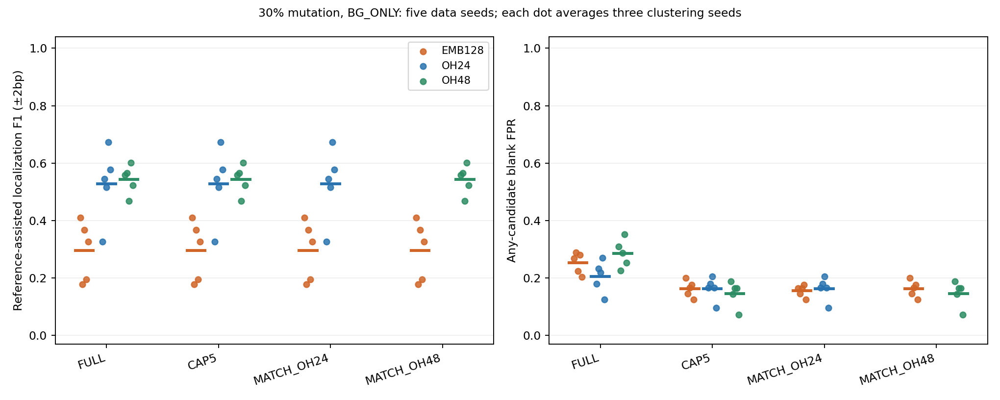

# 背景拒绝的独立复核与候选预算匹配

日期：2026-10-26。协议：EMB-background-budget-validation-20261026-v1。本轮已完成合成验证，未启用真实Holdout或功能验证。

## 结论与后续指导

上一轮的小样本均值优势没有在本轮独立数据上复现。主要比较中双方每次均保留5个候选：BERT的定位F1为0.295，完整One-hot48为0.543，配对均值差−0.248；BERT在5/5组数据中均较低。候选集空白误报均值为0.163对0.146，BERT在5组数据中也均较高。FULL视图的平均F1差距仍存在，不能把结论归因于预算裁剪或零预算；主要比较没有候选不足。

背景拒绝确实改善BERT自身：CAP5下，30%退化从RAW的0.083升至0.295，混合反向链15%退化从0.385升至0.679；但后者仍低于One-hot24的0.861和One-hot48的0.841。One-hot48的混合链RAW为0.879，背景拒绝也不是所有表示的通用改进。强模式控制三种表示均约0.974，与加载和维度核验一起，未显示简单的模型失载或对照维度错误。

据此，建议收束当前“冻结ProkBERT-mini局部表示→PCA/K-Means→背景拒绝”的常规调参，将其保留为补充探索与失败机制材料；主研究继续依托简单基线和传统motif路线。只有提出与本轮明显不同、可证伪的表示或发现机制假设，再开新协议与新Test；本轮不直接启动更多编码器、SAE、微调或真实数据拟合。这里的负面结果只针对当前流程和合成任务，不能推广为所有BERT/DNA语言模型无效，也不构成传统方法已获胜的实测证明。

## 预设问题与完成范围

上一轮BERT BG_ONLY的30%退化均值约0.482，高于同处理One-hot约0.418，但仅1/3数据种子胜出，候选数与误报也不同。本轮检验这个优势在新数据、更充分算法重复及候选预算匹配下是否仍存在，不复用旧Test。

3类条件（强模式、30%退化、混合反向链15%退化）×5新数据种子×3聚类种子，比较BERT局部有序128维、One-hot PCA24及不降维One-hot48。RAW/BG_ONLY均运行。实际135次聚类、270组PWM池；从固定池形成900组预算评价集合，不把子集重复计为新拟合。

每条件Discovery256、Development128、Test128条植入序列，各配同数空白，另有独立校准空白256条。81bp序列、连续12bp人工模式和12bp窗口；BERT权重冻结，局部上下文24bp。人工模式不代表真实−35/−10间距结构。未再跑普通15%退化，聚焦上一轮主要疑问及强模式控制。

数据种子202610263–267，聚类种子20261030/31/32；PCA种子固定。先在每个数据种子内平均3次聚类，再汇总5组数据。下表范围为5个数据均值min/max，不是置信区间，15次运行不是15个独立样本。

同一种子的不同难度条件复用空白随机流，条件之间也不是额外独立重复。exact/RC重复核查的范围为每个条件内部的各分区，不主张跨所有难度条件的每条序列都唯一。

## 排名与预算冻结

候选先按Discovery正类减空白命中率排序，分数阈值为对应PWM的Discovery空白序列最大分95百分位；平局按相对背景的信息量、支持序列数降序及ID升序。没有参考PWM、植入位置或Test参与排名。背景拒绝仍按RAW PWM的Discovery空白最大分95百分位严格筛选实例，至少20条重建一次；不叠加对齐。

- FULL：全部候选，显示完整流程能力。
- CAP5：各自最多5个；候选不足不补造PWM，标记underfill。
- MATCH_OH24 / MATCH_OH48：BERT与对应基线各取同样m个，m=min(5,双方可用数)。m=0保留0分，不删除或算胜出。

共同裁剪可能掩盖候选不足的方法，因此必须同时看FULL/CAP5。所有拟合、Discovery排名、候选成员名单和预算均在任何新Development/Test评分前锁定；本轮未按Test调整方法。

## 主要终点与预设门槛

主要终点为30%退化、BG_ONLY、MATCH_OH48的BERT减完整One-hot48定位F1。状态：**未通过预设进一步研究门槛**。均值差-0.248，5组数据胜出0组，CAP5均值差-0.248。

| 预设检查 | 结果 |
| --- | --- |
| 匹配预算的平均F1差为正 | 未通过 |
| CAP5平均F1差为正 | 未通过 |
| 至少4/5组数据胜出 | 未通过 |
| 共同预算不为零 | 通过 |
| 候选集误报不高于One-hot48 | 未通过 |

门槛要求匹配和CAP5均值差都正、至少4/5数据种子胜出、共同预算不为零、匹配后候选集空白误报不高于One-hot48；它仅决定是否值得更大复核，不是总体/功能优势证明。

| data_seed | f1_emb | f1_baseline | delta | family_fpr_emb | family_fpr_baseline | budget_emb | budget_baseline | zero_budget_count |
| --- | --- | --- | --- | --- | --- | --- | --- | --- |
| 202610263 | 0.411 | 0.558 | -0.147 | 0.201 | 0.188 | 5.000 | 5.000 | 0 |
| 202610264 | 0.178 | 0.566 | -0.388 | 0.146 | 0.143 | 5.000 | 5.000 | 0 |
| 202610265 | 0.367 | 0.468 | -0.101 | 0.167 | 0.164 | 5.000 | 5.000 | 0 |
| 202610266 | 0.194 | 0.602 | -0.408 | 0.177 | 0.164 | 5.000 | 5.000 | 0 |
| 202610267 | 0.327 | 0.522 | -0.196 | 0.125 | 0.073 | 5.000 | 5.000 | 0 |

配对均值符号翻转参照p=0.0625，枚举32种符号分配。其推断依赖零假设下配对差值符号可交换；5组数据的双侧p最小0.0625，因此不能宣称p<.05。其他条件、预算和OH24对照均为探索性。

## 30%退化的预算、误报和覆盖

| view | representation | f1_mean | f1_data_min | f1_data_max | data_seeds | success_fraction | family_blank_fpr | budget | zero_budget_count | underfill_count |
| --- | --- | --- | --- | --- | --- | --- | --- | --- | --- | --- |
| CAP5 | EMB128 | 0.295 | 0.178 | 0.411 | 5 | 0.667 | 0.163 | 5.000 | 0 | 0 |
| CAP5 | OH24 | 0.528 | 0.327 | 0.673 | 5 | 0.933 | 0.163 | 4.733 | 0 | 2 |
| CAP5 | OH48 | 0.543 | 0.468 | 0.602 | 5 | 1.000 | 0.146 | 5.000 | 0 | 0 |
| FULL | EMB128 | 0.295 | 0.178 | 0.411 | 5 | 0.667 | 0.253 | 8.800 | 0 | 0 |
| FULL | OH24 | 0.528 | 0.327 | 0.673 | 5 | 0.933 | 0.205 | 6.200 | 0 | 2 |
| FULL | OH48 | 0.543 | 0.468 | 0.602 | 5 | 1.000 | 0.285 | 10.067 | 0 | 0 |
| MATCH_OH24 | EMB128 | 0.295 | 0.178 | 0.411 | 5 | 0.667 | 0.155 | 4.733 | 0 | 2 |
| MATCH_OH24 | OH24 | 0.528 | 0.327 | 0.673 | 5 | 0.933 | 0.163 | 4.733 | 0 | 2 |
| MATCH_OH48 | EMB128 | 0.295 | 0.178 | 0.411 | 5 | 0.667 | 0.163 | 5.000 | 0 | 0 |
| MATCH_OH48 | OH48 | 0.543 | 0.468 | 0.602 | 5 | 1.000 | 0.146 | 5.000 | 0 | 0 |



budget为每个数据种子内先平均3次算法运行的实际候选数，再跨数据平均。零预算和不足5个的运行没有被删掉。误报是Test空白中任一候选超过自身固定阈值的经验比例，不是正式FDR；数量匹配仍不保证候选相关结构或发现难度相同。

## 全部预设结果

| variant | view | representation | strong_random | mut30_random | mixed_strand_mut15 |
| --- | --- | --- | --- | --- | --- |
| BG_ONLY | CAP5 | EMB128 | 0.974 [0.962, 0.992] | 0.295 [0.178, 0.411] | 0.679 [0.244, 0.881] |
| BG_ONLY | CAP5 | OH24 | 0.974 [0.962, 0.992] | 0.528 [0.327, 0.673] | 0.861 [0.816, 0.904] |
| BG_ONLY | CAP5 | OH48 | 0.974 [0.962, 0.992] | 0.543 [0.468, 0.602] | 0.841 [0.608, 0.926] |
| BG_ONLY | FULL | EMB128 | 0.974 [0.962, 0.992] | 0.295 [0.178, 0.411] | 0.719 [0.447, 0.881] |
| BG_ONLY | FULL | OH24 | 0.974 [0.962, 0.992] | 0.528 [0.327, 0.673] | 0.861 [0.816, 0.904] |
| BG_ONLY | FULL | OH48 | 0.974 [0.962, 0.992] | 0.543 [0.468, 0.602] | 0.890 [0.854, 0.926] |
| BG_ONLY | MATCH_OH24 | EMB128 | 0.974 [0.962, 0.992] | 0.295 [0.178, 0.411] | 0.679 [0.244, 0.881] |
| BG_ONLY | MATCH_OH24 | OH24 | 0.974 [0.962, 0.992] | 0.528 [0.327, 0.673] | 0.861 [0.816, 0.904] |
| BG_ONLY | MATCH_OH48 | EMB128 | 0.974 [0.962, 0.992] | 0.295 [0.178, 0.411] | 0.679 [0.244, 0.881] |
| BG_ONLY | MATCH_OH48 | OH48 | 0.974 [0.962, 0.992] | 0.543 [0.468, 0.602] | 0.841 [0.608, 0.926] |
| RAW | CAP5 | EMB128 | 0.974 [0.962, 0.992] | 0.083 [0.000, 0.271] | 0.385 [0.000, 0.503] |
| RAW | CAP5 | OH24 | 0.974 [0.962, 0.992] | 0.514 [0.327, 0.651] | 0.771 [0.604, 0.858] |
| RAW | CAP5 | OH48 | 0.974 [0.962, 0.992] | 0.511 [0.348, 0.576] | 0.879 [0.794, 0.925] |
| RAW | FULL | EMB128 | 0.974 [0.962, 0.992] | 0.083 [0.000, 0.271] | 0.385 [0.000, 0.503] |
| RAW | FULL | OH24 | 0.974 [0.962, 0.992] | 0.514 [0.327, 0.651] | 0.771 [0.604, 0.858] |
| RAW | FULL | OH48 | 0.974 [0.962, 0.992] | 0.532 [0.453, 0.576] | 0.879 [0.794, 0.925] |
| RAW | MATCH_OH24 | EMB128 | 0.974 [0.962, 0.992] | 0.083 [0.000, 0.271] | 0.385 [0.000, 0.503] |
| RAW | MATCH_OH24 | OH24 | 0.974 [0.962, 0.992] | 0.514 [0.327, 0.651] | 0.771 [0.604, 0.858] |
| RAW | MATCH_OH48 | EMB128 | 0.974 [0.962, 0.992] | 0.083 [0.000, 0.271] | 0.385 [0.000, 0.503] |
| RAW | MATCH_OH48 | OH48 | 0.974 [0.962, 0.992] | 0.511 [0.348, 0.576] | 0.879 [0.794, 0.925] |

评估沿用全12列参考cosine≥.8、方向正确、±2bp参考辅助定位F1。参考只在已冻结的候选子集内作家族匹配，不能找回预算排除的候选。阈值来自独立校准空白最大分95百分位，严格大于；不是FIMO位点p/q，也不是无监督绝对precision。

## 配对比较

| scenario | variant | view | comparator | mean_delta | wins | losses | min_delta | max_delta | family_fpr_emb | family_fpr_baseline |
| --- | --- | --- | --- | --- | --- | --- | --- | --- | --- | --- |
| mixed_strand_mut15 | BG_ONLY | CAP5 | OH24 | -0.182 | 1 | 4 | -0.571 | 0.002 | 0.131 | 0.142 |
| mixed_strand_mut15 | BG_ONLY | CAP5 | OH48 | -0.162 | 0 | 5 | -0.363 | -0.017 | 0.131 | 0.146 |
| mixed_strand_mut15 | BG_ONLY | FULL | OH24 | -0.141 | 1 | 4 | -0.368 | 0.002 | 0.262 | 0.272 |
| mixed_strand_mut15 | BG_ONLY | FULL | OH48 | -0.171 | 0 | 5 | -0.407 | -0.017 | 0.262 | 0.346 |
| mixed_strand_mut15 | BG_ONLY | MATCH_OH24 | OH24 | -0.182 | 1 | 4 | -0.571 | 0.002 | 0.131 | 0.142 |
| mixed_strand_mut15 | BG_ONLY | MATCH_OH48 | OH48 | -0.162 | 0 | 5 | -0.363 | -0.017 | 0.131 | 0.146 |
| mixed_strand_mut15 | RAW | CAP5 | OH24 | -0.386 | 0 | 5 | -0.764 | -0.101 | 0.152 | 0.170 |
| mixed_strand_mut15 | RAW | CAP5 | OH48 | -0.494 | 0 | 5 | -0.794 | -0.407 | 0.152 | 0.146 |
| mixed_strand_mut15 | RAW | FULL | OH24 | -0.386 | 0 | 5 | -0.764 | -0.101 | 0.579 | 0.653 |
| mixed_strand_mut15 | RAW | FULL | OH48 | -0.494 | 0 | 5 | -0.794 | -0.407 | 0.579 | 0.610 |
| mixed_strand_mut15 | RAW | MATCH_OH24 | OH24 | -0.386 | 0 | 5 | -0.764 | -0.101 | 0.152 | 0.170 |
| mixed_strand_mut15 | RAW | MATCH_OH48 | OH48 | -0.494 | 0 | 5 | -0.794 | -0.407 | 0.152 | 0.146 |
| mut30_random | BG_ONLY | CAP5 | OH24 | -0.232 | 1 | 4 | -0.478 | 0.084 | 0.163 | 0.163 |
| mut30_random | BG_ONLY | CAP5 | OH48 | -0.248 | 0 | 5 | -0.408 | -0.101 | 0.163 | 0.146 |
| mut30_random | BG_ONLY | FULL | OH24 | -0.232 | 1 | 4 | -0.478 | 0.084 | 0.253 | 0.205 |
| mut30_random | BG_ONLY | FULL | OH48 | -0.248 | 0 | 5 | -0.408 | -0.101 | 0.253 | 0.285 |
| mut30_random | BG_ONLY | MATCH_OH24 | OH24 | -0.232 | 1 | 4 | -0.478 | 0.084 | 0.155 | 0.163 |
| mut30_random | BG_ONLY | MATCH_OH48 | OH48 | -0.248 | 0 | 5 | -0.408 | -0.101 | 0.163 | 0.146 |
| mut30_random | RAW | CAP5 | OH24 | -0.431 | 0 | 5 | -0.516 | -0.320 | 0.176 | 0.176 |
| mut30_random | RAW | CAP5 | OH48 | -0.429 | 0 | 5 | -0.572 | -0.228 | 0.176 | 0.152 |
| mut30_random | RAW | FULL | OH24 | -0.431 | 0 | 5 | -0.516 | -0.320 | 0.643 | 0.678 |
| mut30_random | RAW | FULL | OH48 | -0.450 | 0 | 5 | -0.572 | -0.228 | 0.643 | 0.667 |
| mut30_random | RAW | MATCH_OH24 | OH24 | -0.431 | 0 | 5 | -0.516 | -0.320 | 0.176 | 0.176 |
| mut30_random | RAW | MATCH_OH48 | OH48 | -0.429 | 0 | 5 | -0.572 | -0.228 | 0.176 | 0.152 |
| strong_random | BG_ONLY | CAP5 | OH24 | 0.000 | 0 | 0 | 0.000 | 0.000 | 0.140 | 0.143 |
| strong_random | BG_ONLY | CAP5 | OH48 | 0.000 | 0 | 0 | 0.000 | 0.000 | 0.140 | 0.144 |
| strong_random | BG_ONLY | FULL | OH24 | 0.000 | 0 | 0 | 0.000 | 0.000 | 0.326 | 0.338 |
| strong_random | BG_ONLY | FULL | OH48 | 0.000 | 0 | 0 | 0.000 | 0.000 | 0.326 | 0.382 |
| strong_random | BG_ONLY | MATCH_OH24 | OH24 | 0.000 | 0 | 0 | 0.000 | 0.000 | 0.140 | 0.143 |
| strong_random | BG_ONLY | MATCH_OH48 | OH48 | 0.000 | 0 | 0 | 0.000 | 0.000 | 0.140 | 0.144 |
| strong_random | RAW | CAP5 | OH24 | 0.000 | 0 | 0 | 0.000 | 0.000 | 0.138 | 0.152 |
| strong_random | RAW | CAP5 | OH48 | 0.000 | 0 | 0 | 0.000 | 0.000 | 0.138 | 0.149 |
| strong_random | RAW | FULL | OH24 | 0.000 | 0 | 0 | 0.000 | 0.000 | 0.607 | 0.622 |
| strong_random | RAW | FULL | OH48 | 0.000 | 0 | 0 | 0.000 | 0.000 | 0.607 | 0.599 |
| strong_random | RAW | MATCH_OH24 | OH24 | 0.000 | 0 | 0 | 0.000 | 0.000 | 0.138 | 0.152 |
| strong_random | RAW | MATCH_OH48 | OH48 | 0.000 | 0 | 0 | 0.000 | 0.000 | 0.138 | 0.149 |

完整逐数据种子差值见 `paired_deltas.tsv`，算法运行和分母见 `metrics.tsv`。不把同一数据的3个算法种子当额外生物学重复；不按Test选择最佳预算、方法或候选。更换测试版本和加入One-hot48后，不能与上一轮均值拼成连续提升曲线。

## 核验与资源

37项相关测试通过，覆盖共同预算、候选不足、禁止参考越过子集、误报不被参考门槛隐藏、完整评分流程与符号翻转边界。1380项产物哈希、996602条实例、4851个重建PWM、135组BG子集关系及900个冻结预算集合核验通过；3342个历史文件哈希不变。

额外重算270组Discovery候选排名，核验7680个植入位置及19200条序列记录，每个条件内部的分区内/间exact/RC重复为0；没有全量近同源审计。以上是产物一致性，不等于独立重新拟合模型。

保存的聚类模型输入维度核验为BERT128=128、One-hot24=24、One-hot48=48；后者确实没有PCA降维。图表已作视觉检查。

Python 3.13.5，Torch 2.7.1 CPU，Transformers 5.8.0；4线程，无GPU。共享拟合约889.6秒，不把共享编码成本当单方法独立时间。固定模型版本/哈希和无缺失权重加载见 `encoder.json`。

STREME环境仍未补齐，不能宣称总体胜过传统方法。真实Holdout未用，SAE、微调、新编码器和真实数据拟合均未执行。若依据本轮Test改方法，另开版本并更换Test种子。

## 复现

```powershell
python -m experiments.pr01_02_embedding_v2.budget_validation_20261026.pipeline fit
python -m experiments.pr01_02_embedding_v2.budget_validation_20261026.pipeline score
python -m experiments.pr01_02_embedding_v2.budget_validation_20261026.qa
python -m experiments.pr01_02_embedding_v2.budget_validation_20261026.pipeline verify
python -m experiments.pr01_02_embedding_v2.budget_validation_20261026.report
```

拟合拒绝覆盖已有目录。权重、特征、人工序列、实例与拟合对象留本地；公开代码、冻结协议、汇总、预算/排名审计、图表及哈希，保留失败与零候选结果。
