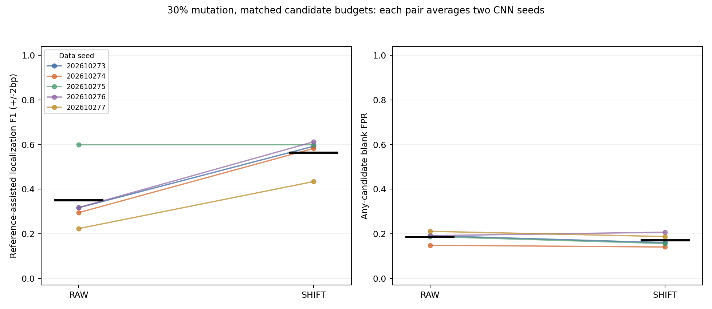

# CNN参考无关边界与方向消融

日期：2026-10-27。协议：CNN-reference-free-boundary-20261027-v1。本轮为新的合成数据验证，完整结果与阴性结果均保留。

## 主要结果与指导

30%退化、匹配候选预算时，TIED_RAW平均定位F1为0.350，TIED_SHIFT为0.564，配对差+0.214；5个新数据种子中SHIFT胜出4个、落后0个。候选集空白误报均值分别为0.186与0.170。**通过预设进一步独立复核门槛**。

先增加模型初始化种子并在新的独立合成数据上复核平移规则，分析候选误报和方向结构；不要直接推断真实生物学效果。

预设门槛仅用于决定是否值得更大规模的独立合成复核，不证明真实启动子功能，也不能把CNN监督方案与OH48的差距直接归因于embedding。主要比较逐数据种子的效果、误报和预算见下表；算法种子不当作独立数据样本。

与OH48同预算比较，30%退化时SHIFT为0.564，OH48为0.579，SHIFT在5个数据种子中胜出1个；两者使用的监督量不同。本次边界处理改善了CNN自身，尚未显示稳定超过OH48。

混合反向链对OH48的5组数据平均差为+0.128，其中数据种子202610277的差为+0.628，其余4组差范围为-0.002到+0.008。该均值受到单组影响明显，不能把它解读为普遍的大幅优势。

事后按10次算法运行拆解主要结果：4次由RAW的全宽参考门槛失败转为SHIFT通过，其余6次RAW已通过且F1保持相同。4次改善均出现在同一个算法种子20261112；另一种子20261113在5组数据中没有F1变化。此项拆解是对已固定结果的探索性解释，10次运行仍只来自5组数据和2个模型初始化，不能当作10次独立重复。收益主要表现为修复部分初始化下的全宽PWM门槛，而不是已通过门槛的候选定位进一步提升；后续应扩大初始化种子复核。

## 方法与公平比较

该方案由[上一轮的窗口偏移诊断](../cnn_features_20261026/REPORT.md)提出，协议在新Test评分前冻结。3种条件（强模式、30%退化、混合反向链15%退化）×5个新数据种子×2算法种子；Discovery植入/空白各256，Development和Test各128/128，另校准空白256。81bp序列和已知12bp连续人工模式不是实测启动子语法。同一种子下不同难度复用空白随机流，条件间不能算独立重复。

实际60次CNN训练、30次OH48聚类、150组PWM池与420组评价集合。TIED与FWD同一数据/种子使用相同初始权重和批次流；TIED训练/提取共用正反向卷积，FWD只用输入正向，最终PWM评价均双链扫描。两者同时改变训练及提取方向，不能称单独只改变推理方向。

每个filter的Discovery正序列先按其Discovery空白最大激活95百分位固定筛选，每个序列最多一个实例。再排除任何±2bp候选窗口越界的实例：RAW与SHIFT使用**同一批**剩余实例，至少20条，配对避免由边界样本变化造成伪差异。RAW保留原窗口；SHIFT对该filter统一比较−2至+2bp五种窗口，选PWM相对于Discovery空白背景的信息量最大的偏移，平局优先绝对偏移较小、再较小的偏移。反向链移动方向按filter方向定义。该规则不读取参考motif、植入真值或Dev/Test，也没有逐实例自由调整；它可能因Discovery随机波动选择错误方向。

注意本轮RAW也剔除边缘不完整窗口，不能与前一轮未剔边缘的RAW直接当作完全相同流程。额外OH48是完整One-hot48 KMeans+背景拒绝，与CNN的序列级正负监督和反向共享归纳偏好不同。

随机权重和打乱标签控制已在上一轮运行，本轮没有重新训练这两类控制；本轮主要识别同一模型、同一保留实例在窗口处理前后的变化，不能把上一轮控制结果当作本轮独立重复。

所有PWM先写入MEME文本，Discovery排序和后续评分均从相同序列化PWM读取，避免上一轮排名与评分PWM精度不一致。排序是Discovery正减空白命中率及固定平局规则，无参考参与。FULL、CAP5，及按两方法共同候选数裁剪的MATCH_SHIFT/MATCH_OH均保留；m=0保留0分。全体模型、实例、平移选择、排名和预算在任何Dev/Test评分前锁定。

RAW和SHIFT分别对各自PWM做Discovery排序，匹配预算不一定产生相同的候选身份。30%退化条件下，10次算法运行中有10次两者的候选集合相同，平均交集5.00个；其他条件的差异可能同时包含重排序影响。参考评价仍可能在同一候选集合中选中不同filter。

## 主要终点逐数据种子

| data_seed | f1_baseline | f1_shift | delta | family_fpr_baseline | family_fpr_shift | budget_baseline | budget_shift | zero_budget_count |
| --- | --- | --- | --- | --- | --- | --- | --- | --- |
| 202610273 | 0.317 | 0.592 | 0.276 | 0.191 | 0.160 | 5.000 | 5.000 | 0 |
| 202610274 | 0.295 | 0.583 | 0.288 | 0.148 | 0.141 | 5.000 | 5.000 | 0 |
| 202610275 | 0.599 | 0.599 | 0.000 | 0.188 | 0.156 | 5.000 | 5.000 | 0 |
| 202610276 | 0.318 | 0.612 | 0.295 | 0.191 | 0.207 | 5.000 | 5.000 | 0 |
| 202610277 | 0.223 | 0.434 | 0.211 | 0.211 | 0.188 | 5.000 | 5.000 | 0 |



图中每条线对应一个数据种子，两端各自平均两个算法种子；黑线为数据均值。候选集合误报是Test空白中任一固定候选超阈值的比例，不是FIMO q或正式FDR。

| 预设门槛 | 结果 |
| --- | --- |
| matched_mean_positive | 通过 |
| at_least4_of5_wins | 通过 |
| cap5_mean_positive | 通过 |
| no_zero_budget | 通过 |
| family_fpr_not_above_raw | 通过 |
| strong_mean_delta_at_least_minus_0_05 | 通过 |

配对符号翻转参照p=0.1250，32种符号分配；它依赖零假设下符号可交换，5组数据双侧p最小0.0625，不能宣称p<.05。CAP5/FULL、OH48、其他场景及方向对照均作探索性解释。

## 30%退化的全部预算和候选误报

| view | representation | f1_mean | f1_min | f1_max | family_blank_fpr | budget | success_fraction | zero_budget_count | underfill_count |
| --- | --- | --- | --- | --- | --- | --- | --- | --- | --- |
| CAP5 | FWD_RAW | 0.313 | 0.208 | 0.447 | 0.173 | 5.000 | 0.600 | 0 | 0 |
| CAP5 | FWD_SHIFT | 0.573 | 0.441 | 0.635 | 0.159 | 5.000 | 1.000 | 0 | 0 |
| CAP5 | OH48_BG | 0.579 | 0.461 | 0.622 | 0.167 | 5.000 | 1.000 | 0 | 0 |
| CAP5 | TIED_RAW | 0.350 | 0.223 | 0.599 | 0.186 | 5.000 | 0.600 | 0 | 0 |
| CAP5 | TIED_SHIFT | 0.564 | 0.434 | 0.612 | 0.170 | 5.000 | 1.000 | 0 | 0 |
| FULL | FWD_RAW | 0.313 | 0.208 | 0.447 | 0.380 | 11.600 | 0.600 | 0 | 0 |
| FULL | FWD_SHIFT | 0.573 | 0.441 | 0.635 | 0.374 | 11.600 | 1.000 | 0 | 0 |
| FULL | OH48_BG | 0.579 | 0.461 | 0.622 | 0.298 | 9.900 | 1.000 | 0 | 0 |
| FULL | TIED_RAW | 0.350 | 0.223 | 0.599 | 0.433 | 11.800 | 0.600 | 0 | 0 |
| FULL | TIED_SHIFT | 0.564 | 0.434 | 0.612 | 0.420 | 11.800 | 1.000 | 0 | 0 |
| MATCH_OH | OH48_BG | 0.579 | 0.461 | 0.622 | 0.167 | 5.000 | 1.000 | 0 | 0 |
| MATCH_OH | TIED_SHIFT | 0.564 | 0.434 | 0.612 | 0.170 | 5.000 | 1.000 | 0 | 0 |
| MATCH_SHIFT | TIED_RAW | 0.350 | 0.223 | 0.599 | 0.186 | 5.000 | 0.600 | 0 | 0 |
| MATCH_SHIFT | TIED_SHIFT | 0.564 | 0.434 | 0.612 | 0.170 | 5.000 | 1.000 | 0 | 0 |

全12列参考cosine≥0.8才允许参考辅助F1，命中方向正确且起点误差≤2bp；参考仅在已锁定子集内选家族，无法找回预算外候选。各PWM阈值来自独立校准空白最大分95百分位；不以Test更改阈值、候选、平移或配置。

## 条件和方向对照：CAP5定位F1

| scenario | FWD_RAW | FWD_SHIFT | OH48_BG | TIED_RAW | TIED_SHIFT |
| --- | --- | --- | --- | --- | --- |
| mixed_strand_mut15 | 0.677 | 0.891 | 0.772 | 0.634 | 0.900 |
| mut30_random | 0.313 | 0.573 | 0.579 | 0.350 | 0.564 |
| strong_random | 0.290 | 0.972 | 0.973 | 0.388 | 0.971 |

RAW和SHIFT是同一个对应方向模型的两个发现输出，不是额外CNN训练。双向与单向比较是包含方向训练和提取的完整流程消融；OH48同样是完整流程对照。数据种子范围和各预算的详细误报、候选数、零预算在 `test_summary.tsv`、`per_data_seed.tsv`。

同一数据种子、CAP5下SHIFT的双向减单向配对比较如下；方向变化并未在所有场景表现出一致优势。

| scenario | mean_tied_minus_forward | tied_wins | tied_losses | ties |
| --- | --- | --- | --- | --- |
| strong_random | -0.001 | 1 | 2 | 2 |
| mut30_random | -0.009 | 1 | 4 | 0 |
| mixed_strand_mut15 | 0.008 | 4 | 1 | 0 |

## 分类与实例边界

| scenario | direction | auroc | average_precision |
| --- | --- | --- | --- |
| mixed_strand_mut15 | FWD | 0.931 | 0.938 |
| mixed_strand_mut15 | TIED | 0.957 | 0.965 |
| mut30_random | FWD | 0.783 | 0.809 |
| mut30_random | TIED | 0.762 | 0.785 |
| strong_random | FWD | 1.000 | 1.000 |
| strong_random | TIED | 1.000 | 1.000 |

分类AUROC/AP仅描述模型对序列级标签的预测，不代表定位正确或功能motif发现。不同方向模型共享初始化与训练标签，但其预测不同；不根据Test分类表现选最终模型。

| 场景与方向 | 筛选后实例 | 越界剔除 | 比例 | 保留filter数 |
| --- | ---: | ---: | ---: | ---: |
| mixed_strand_mut15 / FWD | 12942 | 626 | 0.048 | 116 |
| mixed_strand_mut15 / TIED | 17126 | 739 | 0.043 | 110 |
| mut30_random / FWD | 8772 | 428 | 0.049 | 116 |
| mut30_random / TIED | 7671 | 394 | 0.051 | 118 |
| strong_random / FWD | 24926 | 927 | 0.037 | 110 |
| strong_random / TIED | 24270 | 907 | 0.037 | 101 |

上表的剔除数按filter实例计，同一序列可被不同filter计入多次，不是独立生物样本。RAW/SHIFT对每个filter使用相同剩余实例；不足20条均不产生PWM。保留filter按Discovery选择的平移如下：

| scenario | direction | shift | retained_filters |
| --- | --- | --- | --- |
| mixed_strand_mut15 | FWD | -2 | 23 |
| mixed_strand_mut15 | FWD | -1 | 10 |
| mixed_strand_mut15 | FWD | 0 | 41 |
| mixed_strand_mut15 | FWD | 1 | 23 |
| mixed_strand_mut15 | FWD | 2 | 19 |
| mixed_strand_mut15 | TIED | -2 | 31 |
| mixed_strand_mut15 | TIED | -1 | 8 |
| mixed_strand_mut15 | TIED | 0 | 29 |
| mixed_strand_mut15 | TIED | 1 | 21 |
| mixed_strand_mut15 | TIED | 2 | 21 |
| mut30_random | FWD | -2 | 8 |
| mut30_random | FWD | -1 | 9 |
| mut30_random | FWD | 0 | 70 |
| mut30_random | FWD | 1 | 21 |
| mut30_random | FWD | 2 | 8 |
| mut30_random | TIED | -2 | 6 |
| mut30_random | TIED | -1 | 5 |
| mut30_random | TIED | 0 | 86 |
| mut30_random | TIED | 1 | 19 |
| mut30_random | TIED | 2 | 2 |
| strong_random | FWD | -2 | 37 |
| strong_random | FWD | -1 | 6 |
| strong_random | FWD | 0 | 6 |
| strong_random | FWD | 1 | 17 |
| strong_random | FWD | 2 | 44 |
| strong_random | TIED | -2 | 38 |
| strong_random | TIED | -1 | 6 |
| strong_random | TIED | 0 | 6 |
| strong_random | TIED | 1 | 21 |
| strong_random | TIED | 2 | 30 |

平移数值的单位是filter方向的碱基；反链在原输入坐标中的位移符号相反。选择偏移不使用参考；某一偏移被选不等于找到了真实motif边界。

## 实际核验和限制

25项预拟合相关测试通过；227770条实例和1741个PWM从原始DNA与坐标重建；60组CNN激活、1440项filter平移决策、150组Discovery排序和420组冻结预算集合复算通过，5202个历史保护文件哈希不变。

另核验30组共同初始化、60组训练标签及权重变化，以及30组OH48背景拒绝实例；各条件内/跨分区exact/RC重复为0、7680个植入位点正确。未做全量近同源审计或独立重新训练，真值仅用于评分/核验。

Python 3.13.5、Torch 2.7.1、CPU 4线程，整批拟合连同事前历史文件哈希核验约333.3秒；不能把共享成本当成单个模型独立计时。真实Holdout未使用，未执行真实数据拟合、SAE或生物学功能验证。

## 复现与材料

```powershell
python -m experiments.pr01_02_embedding_v2.cnn_boundary_20261027.pipeline fit
python -m experiments.pr01_02_embedding_v2.cnn_boundary_20261027.pipeline score
python -m experiments.pr01_02_embedding_v2.cnn_boundary_20261027.qa
python -m experiments.pr01_02_embedding_v2.cnn_boundary_20261027.pipeline verify
python -m experiments.pr01_02_embedding_v2.cnn_boundary_20261027.report
```

拟合拒绝覆盖旧artifacts。人工序列、模型、实例与聚类对象留本地，公开协议、源码、分数据种子统计、shift/边界记录、图和哈希。严格字节哈希只适用于该环境下原始产物；重训需另开目录并报告环境差异。
