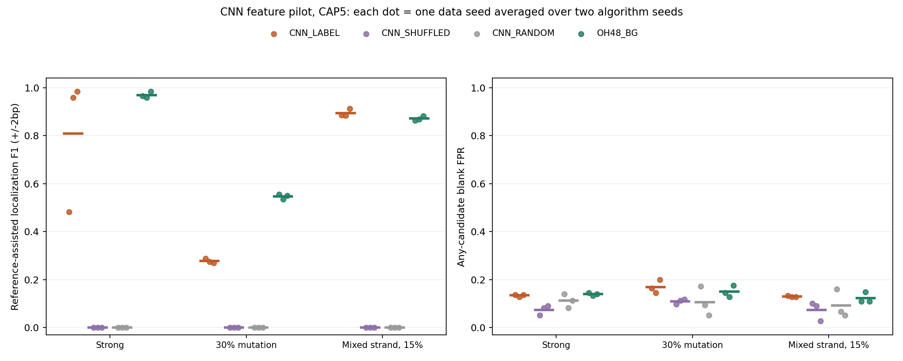

# 老师推荐路线：CNN局部特征与卷积核提取小试

日期：2026-10-26。协议：CNN-local-features-20261026-v1。当前BERT聚类线路已阶段性收束，本轮未重训或调优BERT。

## 结果与下一步

主要终点为30%退化的匹配候选预算定位F1：CNN_LABEL 0.277，OH48_BG 0.547，配对平均差-0.270，3组数据胜出0组。**未通过进一步独立复核的小试门槛**。

CAP5下CNN_LABEL/打乱标签/随机权重/OH48_BG的F1分别为0.277/0.000/0.000/0.547。主要终点的候选集空白误报为CNN 0.169、OH48 0.150。必须结合下表预算与不足候选次数解释，不能因共同裁剪掩盖发现失败。

当前不扩大到真实数据，也不继续按本轮Test调参数。下一步优先为CNN定义不依赖参考的卷积窗口边界处理，单列方向共享结构的消融，并在新协议和新Test中验证；不回到BERT常规调参，不直接启动SAE。

混合反向链15%退化CAP5中，CNN_LABEL为0.894，OH48为0.871，三个数据种子差值均正；但候选集误报也稍高（0.130/0.122），且CNN使用序列级监督和双向共享卷积，不能归因为单纯表示优势。强模式CNN约0.809，对照约0.970，CNN仅5/6算法运行通过全宽PWM门槛。随机权重和打乱标签两对照的定位F1均为0，没有证据支持未经训练的卷积特征本身就能恢复模式。

## 为什么选择此路线

依据老师methods PDF pp.1–4与overview PDF p.1，先运行CNN卷积特征→高激活实例→PWM。两份原文及原始论文核对见[老师方法选择记录](../closeout_20261026/teacher_methods.md)。SAE虽受材料重点介绍，蛋白研究不能直接算DNA验证，故未启动；也未更换大型PLM。完整旧BERT材料见[收束索引](../closeout_20261026/CLOSEOUT.md)。

当前是借鉴DeepBind范式的自建CPU小模型，并非其完整复现或发布权重。输入为81bp One-hot，24个宽12卷积核+ReLU；两个方向共享卷积权重，取全局最大后由线性头输出二分类logit，共1201参数。24维局部激活为新表示；高响应窗口直接还原DNA，不再用BERT表示聚类。

## 冻结设计与监督差异

3条件×3新数据种子202610270–272×2算法种子20261110/11。每条件Discovery正/空白各256、Development与Test正/空白各128，另校准空白256。强模式、30%退化、混合反向链15%退化；连续12bp人工模式，不代表真实启动子−35/−10结构。不同难度条件同数据种子的空白随机流复用，不能当额外独立重复。

实际36个CNN训练、18个未训练随机模型、18次OH48聚类，72组PWM池与180组冻结评价集合。36个训练包括正常标签和打乱标签各18个；算法重复先在同一数据种子内平均，独立数据重复仅3组，范围不是置信区间。

CNN_LABEL仅用Discovery序列级正负标签训练固定80轮，Adam lr=.005、weight_decay=.0001、batch64；不见植入位置、方向、pattern或验证数据。CNN_SHUFFLED用相同初始化和固定打乱标签，CNN_RANDOM保留同一初始权重。OH48保持原完整48维One-hot KMeans+背景拒绝，无PCA。CNN额外利用分类标签及反向互补共享结构，结果只能比较完整流程，不能归因为纯粹embedding优劣或无监督方法胜出。

不按Development/Test选epoch、阈值、宽度、滤波器或新方法。所有模型、PWM、Discovery排名及预算成员锁定后才评分。真实Holdout未使用，未运行真实序列拟合、SAE、微调、FIMO或生物学功能实验。

## 实例提取与评价

CNN对每个filter、每条Discovery正序列只取双链最大激活窗口，严格高于对应filter的Discovery空白最大激活95百分位才保留；至少20条序列。反链窗口坐标先还原到输入串，再将片段反向互补到filter方向后重建PWM，伪计数0.5。OH48按旧背景拒绝流程重建一次。没有使用参考PWM或真值对齐候选。

所有方法仅按Discovery正类减空白命中率排序，平局用信息量、支持数和ID；输出FULL与CAP5，另CNN_LABEL和OH48各取共同m=min(5,双方可用数)形成MATCH_OH48。零候选保留0分，不删除或当胜出。

固定PWM由独立校准空白最大扫描分95百分位定阈值，再扫描Development/Test双链。主要F1为全12列参考cosine≥.8、方向正确、起点±2bp的参考辅助恢复；参考仅在冻结候选集合内选家族，不能找回排除候选。候选集误报不受参考门槛隐藏，不是正式FDR/FIMO q。不能把该F1当绝对无监督precision。

## Test定位、预算与误报

| scenario | view | representation | f1_mean | f1_min | f1_max | family_blank_fpr | budget | success_fraction | zero_budget_count | underfill_count |
| --- | --- | --- | --- | --- | --- | --- | --- | --- | --- | --- |
| mixed_strand_mut15 | CAP5 | CNN_LABEL | 0.894 | 0.884 | 0.913 | 0.130 | 5.000 | 1.000 | 0 | 0 |
| mixed_strand_mut15 | CAP5 | CNN_RANDOM | 0.000 | 0.000 | 0.000 | 0.092 | 2.000 | 0.000 | 2 | 6 |
| mixed_strand_mut15 | CAP5 | CNN_SHUFFLED | 0.000 | 0.000 | 0.000 | 0.073 | 1.667 | 0.000 | 2 | 5 |
| mixed_strand_mut15 | CAP5 | OH48_BG | 0.871 | 0.863 | 0.882 | 0.122 | 5.000 | 1.000 | 0 | 0 |
| mixed_strand_mut15 | FULL | CNN_LABEL | 0.894 | 0.884 | 0.913 | 0.285 | 9.833 | 1.000 | 0 | 0 |
| mixed_strand_mut15 | FULL | CNN_RANDOM | 0.000 | 0.000 | 0.000 | 0.092 | 2.000 | 0.000 | 2 | 6 |
| mixed_strand_mut15 | FULL | CNN_SHUFFLED | 0.000 | 0.000 | 0.000 | 0.073 | 1.667 | 0.000 | 2 | 5 |
| mixed_strand_mut15 | FULL | OH48_BG | 0.871 | 0.863 | 0.882 | 0.296 | 13.667 | 1.000 | 0 | 0 |
| mixed_strand_mut15 | MATCH_OH48 | CNN_LABEL | 0.894 | 0.884 | 0.913 | 0.130 | 5.000 | 1.000 | 0 | 0 |
| mixed_strand_mut15 | MATCH_OH48 | OH48_BG | 0.871 | 0.863 | 0.882 | 0.122 | 5.000 | 1.000 | 0 | 0 |
| mut30_random | CAP5 | CNN_LABEL | 0.277 | 0.269 | 0.289 | 0.169 | 5.000 | 0.500 | 0 | 0 |
| mut30_random | CAP5 | CNN_RANDOM | 0.000 | 0.000 | 0.000 | 0.105 | 2.500 | 0.000 | 1 | 5 |
| mut30_random | CAP5 | CNN_SHUFFLED | 0.000 | 0.000 | 0.000 | 0.109 | 2.000 | 0.000 | 0 | 6 |
| mut30_random | CAP5 | OH48_BG | 0.547 | 0.535 | 0.555 | 0.150 | 5.000 | 1.000 | 0 | 0 |
| mut30_random | FULL | CNN_LABEL | 0.277 | 0.269 | 0.289 | 0.336 | 9.667 | 0.500 | 0 | 0 |
| mut30_random | FULL | CNN_RANDOM | 0.000 | 0.000 | 0.000 | 0.111 | 2.667 | 0.000 | 1 | 5 |
| mut30_random | FULL | CNN_SHUFFLED | 0.000 | 0.000 | 0.000 | 0.109 | 2.000 | 0.000 | 0 | 6 |
| mut30_random | FULL | OH48_BG | 0.547 | 0.535 | 0.555 | 0.268 | 10.500 | 1.000 | 0 | 0 |
| mut30_random | MATCH_OH48 | CNN_LABEL | 0.277 | 0.269 | 0.289 | 0.169 | 5.000 | 0.500 | 0 | 0 |
| mut30_random | MATCH_OH48 | OH48_BG | 0.547 | 0.535 | 0.555 | 0.150 | 5.000 | 1.000 | 0 | 0 |
| strong_random | CAP5 | CNN_LABEL | 0.809 | 0.483 | 0.985 | 0.134 | 5.000 | 0.833 | 0 | 0 |
| strong_random | CAP5 | CNN_RANDOM | 0.000 | 0.000 | 0.000 | 0.112 | 2.333 | 0.000 | 1 | 5 |
| strong_random | CAP5 | CNN_SHUFFLED | 0.000 | 0.000 | 0.000 | 0.074 | 1.500 | 0.000 | 0 | 6 |
| strong_random | CAP5 | OH48_BG | 0.970 | 0.959 | 0.985 | 0.139 | 5.000 | 1.000 | 0 | 0 |
| strong_random | FULL | CNN_LABEL | 0.809 | 0.483 | 0.985 | 0.249 | 9.833 | 0.833 | 0 | 0 |
| strong_random | FULL | CNN_RANDOM | 0.000 | 0.000 | 0.000 | 0.116 | 2.500 | 0.000 | 1 | 5 |
| strong_random | FULL | CNN_SHUFFLED | 0.000 | 0.000 | 0.000 | 0.074 | 1.500 | 0.000 | 0 | 6 |
| strong_random | FULL | OH48_BG | 0.970 | 0.959 | 0.985 | 0.359 | 16.333 | 1.000 | 0 | 0 |
| strong_random | MATCH_OH48 | CNN_LABEL | 0.809 | 0.483 | 0.985 | 0.134 | 5.000 | 0.833 | 0 | 0 |
| strong_random | MATCH_OH48 | OH48_BG | 0.970 | 0.959 | 0.985 | 0.139 | 5.000 | 1.000 | 0 | 0 |



图中每点为一个数据种子内两次算法运行的均值，横线为三个数据种子的平均。CAP5的候选不足不补造。

## 主要终点逐数据种子

| data_seed | f1_cnn | f1_oh | delta | family_blank_fpr_cnn | family_blank_fpr_oh | budget_cnn | budget_oh | zero_budget_count_cnn |
| --- | --- | --- | --- | --- | --- | --- | --- | --- |
| 202610270 | 0.289 | 0.555 | -0.267 | 0.164 | 0.145 | 5.000 | 5.000 | 0 |
| 202610271 | 0.274 | 0.535 | -0.261 | 0.145 | 0.129 | 5.000 | 5.000 | 0 |
| 202610272 | 0.269 | 0.551 | -0.282 | 0.199 | 0.176 | 5.000 | 5.000 | 0 |

| check | passed |
| --- | --- |
| matched_mean_positive | False |
| all3_data_seeds_positive | False |
| cap5_exceeds_controls_and_oh | False |
| no_zero_common_budget | True |
| family_fpr_not_above_oh | False |

门槛只决定是否值得新数据复核，不是显著性或功能优势证明。n=3不作总体优越推断。历史BERT使用不同Test，不能将其旧均值与本表当同批配对结果。

## 分类单独报告

| scenario | method | auroc | average_precision | accuracy_logit0 |
| --- | --- | --- | --- | --- |
| mixed_strand_mut15 | CNN_LABEL | 0.953 | 0.959 | 0.893 |
| mixed_strand_mut15 | CNN_RANDOM | 0.543 | 0.550 | 0.500 |
| mixed_strand_mut15 | CNN_SHUFFLED | 0.525 | 0.540 | 0.514 |
| mut30_random | CNN_LABEL | 0.775 | 0.788 | 0.706 |
| mut30_random | CNN_RANDOM | 0.530 | 0.541 | 0.500 |
| mut30_random | CNN_SHUFFLED | 0.492 | 0.505 | 0.503 |
| strong_random | CNN_LABEL | 1.000 | 1.000 | 0.996 |
| strong_random | CNN_RANDOM | 0.566 | 0.564 | 0.500 |
| strong_random | CNN_SHUFFLED | 0.523 | 0.526 | 0.515 |

分类AUROC/AP和固定logit>0准确率使用原始正负标签评价，包括打乱标签训练模型。分类有效不代表发现正确位点；具体实例/PWM/定位结果以上表为准。未训练随机分类头的分数方向也未按Test翻转。

## 评分后的边界诊断（探索性）

在固定评分结束后，才对已锁定CNN_LABEL CAP5候选增加最少8列重叠的参考相似诊断；没有据此移动PWM、重新排名、放宽主要门槛或改写任何F1。4次全宽门槛失败（强模式1次、30%退化3次）在原候选子集中都含10–11列的高相似部分模式（cosine约0.983–1.000），对应1–2bp偏移。保存Discovery实例的起点绝对误差中位数也为1–2bp，提示卷积感受野与完整模式边界错位是具体候选瓶颈；不代表完整12bp模式已恢复。

分类方面，强模式AUROC约1.000、弱模式约0.775、混合链约0.953，而定位仍受边界及全宽门槛限制。这为下一版CNN的参考无关实例边界设计提供假设，尚不能证明任何边界修正会有效。逐运行表见 `boundary_diagnostics.tsv`，诊断明确使用参考和Discovery真值，不能作为独立验证或发现算法输入。

## 核验、成本与保留材料

预拟合22项相关测试通过。58735条实例的DNA/坐标/方向与493个PWM重建一致；重算72组Discovery排名、54组保存CNN的完整Discovery激活，并核对4608个植入位置与180个预算集合。4732个历史文件哈希不变。

额外核对18组随机权重确为共同初始状态、36组标签流/训练后权重变化，独立从聚类分配重建18组OH48背景拒绝实例。各条件内部各分区内/间exact/RC重复为0；未作近同源审计、独立重新训练或功能验证。

首次原始 `pipeline verify` 在排名浮点字段完全相等检查失败：拟合时排名由未舍入PWM计算，MEME文本只保存8位小数。独立核验器从保存实例重建原精度PWM，72组原始排名全部精确复现；从文本PWM重算的候选身份/顺序改变0组。PWM最大绝对舍入误差5e-10；个别严格阈值命中的比例变化为1/256。差异及原失败记录见 `precision_audit.json`、`original_verifier_failure.json`。模型、冻结源码、排名、预算及评分均未修改；评分使用最初锁定的文本PWM。后续重验使用 `verify_artifacts`，而不是声称原检查通过。

Python 3.13.5，Torch 2.7.1，CPU4线程、无GPU。全部拟合约158.3秒，为整批共享成本，非单方法独立基准。训练曲线、分类明细、分数据种子与预算统计、源码/协议锁、产物哈希公开；人工序列、权重、实例、PWM和拟合对象留本地artifacts。旧BERT的84份再生成编码缓存已按单独清单腾退，模型和实例证据保留。

## 复现

```powershell
python -m experiments.pr01_02_embedding_v2.cnn_features_20261026.pipeline fit
python -m experiments.pr01_02_embedding_v2.cnn_features_20261026.pipeline score
python -m experiments.pr01_02_embedding_v2.cnn_features_20261026.qa
python -m experiments.pr01_02_embedding_v2.cnn_features_20261026.diagnose
python -m experiments.pr01_02_embedding_v2.cnn_features_20261026.verify_artifacts
python -m experiments.pr01_02_embedding_v2.cnn_features_20261026.report
```

fit拒绝覆盖已有目录。验证哈希针对原始运行字节；换环境重新训练未必字节一致，应单列复现差异，不能覆盖本轮产物。任何依据本轮Test的后续修改必须新协议和新Test。
