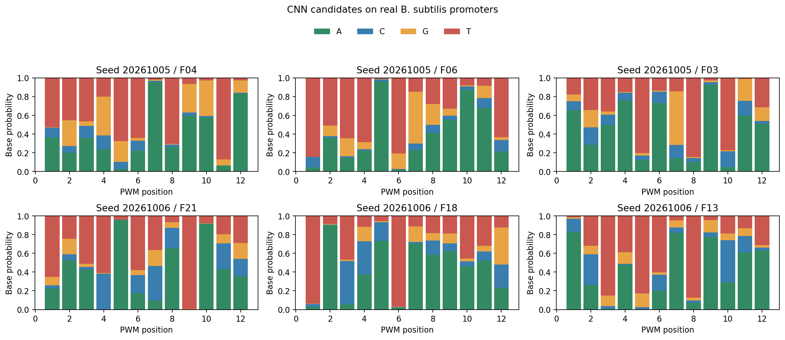

# CNN 真实数据 Motif 候选小试

使用与传统 MEME/STREME 相同的 TJU B. subtilis 冻结数据：Discovery 正类 473、天然对照 559；Development 正类 67、天然对照 77。共训练2个 CNN，使用序列级正负标签；只用 Discovery 拟合和排序，Development 在过去已被观察，本轮属于探索。未使用 Holdout。

每个滤波器按 Discovery 天然对照激活的90%分位选择支持实例，至少10条，并比较原窗口与 Discovery 信息量选择的 ±2bp 统一平移。按 Discovery 命中差排序；各方法候选按天然对照90%分位阈值进行同一双链扫描。Development 天然对照比较按同源组计数：正类66组、天然负类77组；Shuffle 按正类同源组配对。不同候选的阈值按同一规则分别计算，并非 FIMO p/q。

## 前3个候选的序列组命中

| 方法 | 种子 | 正类命中 | 天然负类命中 | 正类减天然 | 配对 Shuffle 命中 |
| --- | --- | ---: | ---: | ---: | ---: |
| STREME | existing | 0.848 | 0.182 | +0.667 | 0.652 |
| CNN_RAW | 20261005 | 0.848 | 0.325 | +0.524 | 0.667 |
| CNN_SHIFT | 20261005 | 0.848 | 0.325 | +0.524 | 0.667 |
| CNN_RAW | 20261006 | 0.818 | 0.247 | +0.571 | 0.652 |
| CNN_SHIFT | 20261006 | 0.818 | 0.247 | +0.571 | 0.652 |

对照为原有3个已筛选 STREME 主候选，候选来源与 CNN 不同；MEME 和全部 STREME 候选尚未纳入，因此本表是初步参考，不是完整方法排名。所有候选集合的结果另见[family.tsv](family.tsv)。

## CNN 平移候选展示

上图为 PWM 每个位置的碱基概率，分别取两次运行 Discovery 排名前3；不是功能强度。下表比较既有同数据 STREME 主候选的局部相似，该参考并非独立来源。

| 种子 | 候选 | 最相似 STREME | 重叠长度 | 中心化余弦 | 正类命中 | 天然对照 | Shuffle |
| --- | --- | --- | ---: | ---: | ---: | ---: | ---: |
| 20261005 | F04 | 1-TATAATAAAWA | 7/11 | 0.952 | 0.652 | 0.130 | 0.409 |
| 20261005 | F06 | 2-TAAAAAWA | 7/8 | 0.761 | 0.576 | 0.130 | 0.424 |
| 20261005 | F03 | 1-TATAATAAAWA | 6/11 | 0.845 | 0.561 | 0.156 | 0.515 |
| 20261006 | F21 | 1-TATAATAAAWA | 10/11 | 0.883 | 0.591 | 0.104 | 0.409 |
| 20261006 | F18 | 1-TATAATAAAWA | 11/11 | 0.906 | 0.621 | 0.078 | 0.500 |
| 20261006 | F13 | 1-TATAATAAAWA | 9/11 | 0.802 | 0.424 | 0.130 | 0.394 |

两个种子各有1个保留滤波器的最佳平移不是0；前3候选的 RAW 与 SHIFT 命中相同，不能据此声称平移带来改善。更多候选和各运行结果见 [candidates.tsv](candidates.tsv)、[selected_candidates.tsv](selected_candidates.tsv) 和 [family.tsv](family.tsv)。

本次候选是实际 CNN 输出，不等于验证的功能 motif；CNN 使用序列标签监督，打乱背景命中提示需要继续检查序列组成及候选特异性。下一步可先核对两种子候选的位置和实例，再按同一数据与口径补齐完整 MEME/STREME、One-hot 和 BERT 对照。

[拟合锁与来源](fit_lock.json)｜[评价哈希](score_manifest.json)｜[核验](verification.json)｜[方案](../README.md)。
