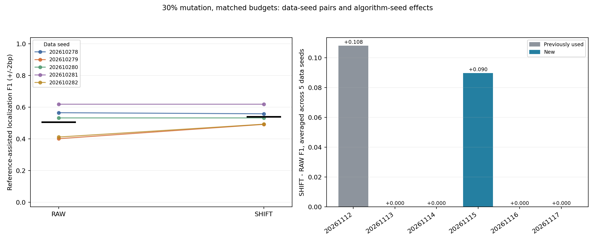

# CNN边界处理：多算法种子独立复核

日期：2026-10-27。协议：CNN-boundary-initialization-replication-20261027-v1。本轮为新合成数据和扩展初始化的复核，完整阴性结果保留。

## 主要结果与下一步

30%退化、匹配候选预算时，RAW定位F1 0.506，SHIFT 0.539，配对差+0.033；5组新数据中SHIFT胜出2组、落后1组，4个全新初始化中有1个跨5组数据的平均差为正。候选集空白误报均值为0.138/0.121。**未通过预设进一步合成研究门槛**。

将边界处理保留为候选诊断，暂不把它作为稳定提升；若要厘清随机性，先用新协议和新Test独立改变模型权重初始化与训练批次顺序，再扩展人工模式及背景。 门槛只决定是否值得进一步合成研究；CNN使用序列级监督，OH48没有同样的分类训练，比较不能直接归因为embedding本身。真实Holdout未用，不能据此宣称真实功能motif或总体模型优势。

匹配5候选条件下，30%退化的SHIFT为0.539，OH48为0.510；SHIFT在5组数据中胜出4组、落后1组。混合反向链对OH48的平均差为+0.023，其中最大绝对差来自数据种子202610282（+0.059），其余4组差范围为+0.009到+0.023；均值是否受单组影响须结合逐数据结果。

30%退化对OH48的平均差为+0.028，其中数据种子202610278的差为+0.110，其余4组范围-0.019至+0.019；这是带序列级监督的CNN与无同等分类训练的OH48在5组人工数据上的流程对照，不构成一般性或统计显著优势。

## 固定方法与数据

复用[上一轮已冻结边界方法](../cnn_boundary_20261027/REPORT.md)：双向共享CNN按Discovery序列级正负标签训练，两个PWM方案共用同一模型和同一批边界有效的高激活实例。RAW保持原窗口，SHIFT对每个filter只凭Discovery相对背景信息量在−2到+2bp中选一个统一平移。序列级标签可见；植入位置、参考PWM、Development/Test均不进入拟合、平移或排名。边缘±2bp不完整的实例在两方案均排除，至少20条；参照OH48不使用同样的监督与方向共享。

3条件（强模式、30%退化、混合反向链15%退化）×5个新数据种子202610278–202610282×6初始化20261112–20261117；其中20261112/20261113是上一轮使用过的初始化，20261114–20261117为新增。每条件Discovery植入/空白各256，Development/Test各128/128，另校准空白256。随机种子之间共享同一数据；同一数据种子的不同难度共享空白随机流，不把初始化或场景视作额外独立数据。人工连续12bp模式与真实启动子元件语法不同，窗口宽度预先已知。

沿用上一轮的训练实现：CNN算法种子同时设定初始权重和训练批次顺序；本轮比较的是两项共同改变的稳定性，不能将差异只归因于初始权重。OH48使用同编号作为其聚类随机种子；这两个方法并未共享随机算法或监督方式。

实际90次CNN训练、90次OH48聚类、270组PWM池、900组预算评价。RAW/SHIFT复用模型和同一实例，不算额外训练。FULL、CAP5和两组匹配预算在Discovery排序后固定，零候选保留0分。全部模型、PWM、平移和候选集合先锁定，再一次性评分Development/Test；不按新Test选择种子、方法、阈值或子集。

## 主要终点逐数据种子

| data_seed | f1_baseline | f1_shift | delta | family_fpr_baseline | family_fpr_shift | budget_baseline | budget_shift | zero_budget_count |
| --- | --- | --- | --- | --- | --- | --- | --- | --- |
| 202610278 | 0.565 | 0.558 | -0.007 | 0.129 | 0.122 | 5.000 | 5.000 | 0 |
| 202610279 | 0.401 | 0.491 | 0.091 | 0.161 | 0.120 | 5.000 | 5.000 | 0 |
| 202610280 | 0.532 | 0.532 | 0.000 | 0.150 | 0.130 | 5.000 | 5.000 | 0 |
| 202610281 | 0.619 | 0.619 | 0.000 | 0.135 | 0.129 | 5.000 | 5.000 | 0 |
| 202610282 | 0.411 | 0.492 | 0.081 | 0.113 | 0.103 | 5.000 | 5.000 | 0 |



左图每条线为同一数据种子在6个算法种子上的平均；右图每根柱为同一算法种子在5组数据的平均差。每个算法种子同时控制权重初始化和训练批次顺序，所有算法种子共享数据，柱数不是独立数据样本数。

| 预设门槛 | 结果 |
| --- | --- |
| matched_mean_positive | 通过 |
| at_least4_of5_data_wins | 未通过 |
| at_least3_of4_new_initializations_positive | 未通过 |
| cap5_mean_positive | 通过 |
| no_zero_budget | 通过 |
| family_fpr_not_above_raw | 通过 |
| strong_mean_delta_at_least_minus_0_05 | 通过 |

符号翻转参照p=0.5000，按5个数据均值枚举32种符号分配；依赖零假设下符号可交换。5组数据双侧p最小0.0625，不宣称p<.05。

## 逐算法种子拆解

| algorithm_seed | cohort | mean_delta | data_seeds | data_wins | data_losses |
| --- | --- | --- | --- | --- | --- |
| 20261112 | reused | 0.108 | 5 | 2 | 0 |
| 20261113 | reused | 0.000 | 5 | 0 | 0 |
| 20261114 | new | 0.000 | 5 | 0 | 0 |
| 20261115 | new | 0.090 | 5 | 1 | 1 |
| 20261116 | new | 0.000 | 5 | 0 | 0 |
| 20261117 | new | 0.000 | 5 | 0 | 0 |

当前30%退化的30次算法运行中，2次由RAW未通过全宽参考门槛转为SHIFT通过，0次由通过转为未通过；26次RAW/SHIFT F1相同。这是对已固定评分的事后描述；5组数据×6初始化并非30组独立数据。

新增算法种子中，平均差为正的种子其正负数据组数见上表；较少数数据上的变化可以驱动单种子平均差，不应只凭其符号认定跨数据稳定。

RAW与SHIFT分别按Discovery重排序。30%退化的30次算法运行中有23次匹配预算的候选集合相同，平均交集4.77个。身份相同不保证评分时选中同一个filter；完整结果也须看FULL和CAP5。

## 条件、预算、误报和分类

| scenario | OH48_BG | TIED_RAW | TIED_SHIFT |
| --- | --- | --- | --- |
| mixed_strand_mut15 | 0.894 | 0.885 | 0.918 |
| mut30_random | 0.510 | 0.506 | 0.539 |
| strong_random | 0.974 | 0.654 | 0.979 |

| view | representation | f1_mean | f1_min | f1_max | family_blank_fpr | budget | success_fraction | zero_budget_count | underfill_count |
| --- | --- | --- | --- | --- | --- | --- | --- | --- | --- |
| CAP5 | OH48_BG | 0.510 | 0.448 | 0.603 | 0.136 | 5.000 | 0.967 | 0 | 0 |
| CAP5 | TIED_RAW | 0.506 | 0.401 | 0.619 | 0.138 | 5.000 | 0.933 | 0 | 0 |
| CAP5 | TIED_SHIFT | 0.539 | 0.491 | 0.619 | 0.121 | 5.000 | 1.000 | 0 | 0 |
| FULL | OH48_BG | 0.510 | 0.448 | 0.603 | 0.253 | 9.833 | 0.967 | 0 | 0 |
| FULL | TIED_RAW | 0.506 | 0.401 | 0.619 | 0.356 | 11.667 | 0.933 | 0 | 0 |
| FULL | TIED_SHIFT | 0.539 | 0.491 | 0.619 | 0.340 | 11.667 | 1.000 | 0 | 0 |
| MATCH_OH | OH48_BG | 0.510 | 0.448 | 0.603 | 0.136 | 5.000 | 0.967 | 0 | 0 |
| MATCH_OH | TIED_SHIFT | 0.539 | 0.491 | 0.619 | 0.121 | 5.000 | 1.000 | 0 | 0 |
| MATCH_SHIFT | TIED_RAW | 0.506 | 0.401 | 0.619 | 0.138 | 5.000 | 0.933 | 0 | 0 |
| MATCH_SHIFT | TIED_SHIFT | 0.539 | 0.491 | 0.619 | 0.121 | 5.000 | 1.000 | 0 | 0 |

严格全12列参考cosine≥0.8才计算参考辅助F1，命中方向正确、起点误差≤2bp；参考只从冻结候选中选择家族，不用于生成/调整候选。各PWM阈值来自独立校准空白最大分95百分位。候选集误报是Test空白中任一固定候选超阈值的比例，不是FIMO q或正式FDR。

| scenario | auroc | average_precision |
| --- | --- | --- |
| mixed_strand_mut15 | 0.971 | 0.975 |
| mut30_random | 0.768 | 0.789 |
| strong_random | 1.000 | 1.000 |

分类AUROC/AP只描述序列级分类，不等于定位成功或motif功能证据。

## 平移选择与边界排除

| scenario | activation_selected | edge_excluded | retained_filters | excluded_fraction |
| --- | --- | --- | --- | --- |
| mixed_strand_mut15 | 55206 | 2473 | 349 | 0.045 |
| mut30_random | 25577 | 1203 | 350 | 0.047 |
| strong_random | 79475 | 2573 | 334 | 0.032 |

| scenario | shift | retained_filters |
| --- | --- | --- |
| mixed_strand_mut15 | -2 | 71 |
| mixed_strand_mut15 | -1 | 41 |
| mixed_strand_mut15 | 0 | 125 |
| mixed_strand_mut15 | 1 | 36 |
| mixed_strand_mut15 | 2 | 76 |
| mut30_random | -2 | 14 |
| mut30_random | -1 | 35 |
| mut30_random | 0 | 258 |
| mut30_random | 1 | 35 |
| mut30_random | 2 | 8 |
| strong_random | -2 | 93 |
| strong_random | -1 | 32 |
| strong_random | 0 | 55 |
| strong_random | 1 | 36 |
| strong_random | 2 | 118 |

剔除数按filter实例计，同一序列可以被多个filter计入；RAW/SHIFT共享每个filter的剩余实例。偏移由Discovery信息量决定，频次本身不证明找对真实边界。

## 核验与限制

18项预拟合相关测试通过；455907条实例和3267个PWM由输入DNA/坐标重建，复算90组CNN激活、2160项平移、270组Discovery排序及900组预算集合；5991个历史保护文件哈希不变。另核验90组模型初始化、训练标签与权重变化，并重建90组OH48背景筛选。

每个条件内各分区的exact/RC重复为0，并与前3轮合成实验比较，跨版本exact/RC重合均为0（见 `cross_version_qa.json`）；没有全面近同源审计，不能称绝对生物学独立。7680个植入真值仅用于评分和核验。没有独立重训、真实数据拟合、SAE、FIMO或功能验证。

Python 3.13.5，Torch 2.7.1，CPU4线程；整批拟合含事前历史哈希核验约470.9秒，不当作单模型独立计时。真实Holdout未使用。

## 复现

```powershell
python -m experiments.pr01_02_embedding_v2.cnn_seed_validation_20261027.pipeline fit
python -m experiments.pr01_02_embedding_v2.cnn_seed_validation_20261027.pipeline score
python -m experiments.pr01_02_embedding_v2.cnn_seed_validation_20261027.pipeline qa
python -m experiments.pr01_02_embedding_v2.cnn_seed_validation_20261027.qa_cross_version
python -m experiments.pr01_02_embedding_v2.cnn_seed_validation_20261027.report --figure-only
python -m experiments.pr01_02_embedding_v2.cnn_seed_validation_20261027.pipeline verify
python -m experiments.pr01_02_embedding_v2.cnn_seed_validation_20261027.report
```

拟合拒绝覆盖已有artifacts。人工序列、模型、实例、聚类对象保留本地，公开协议、代码、聚合/分数据与分初始化统计、边界记录、图表和哈希。原始字节哈希只对应原环境，重训请另开输出目录并说明环境差异。
