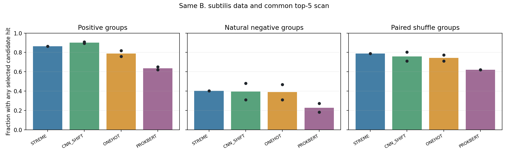
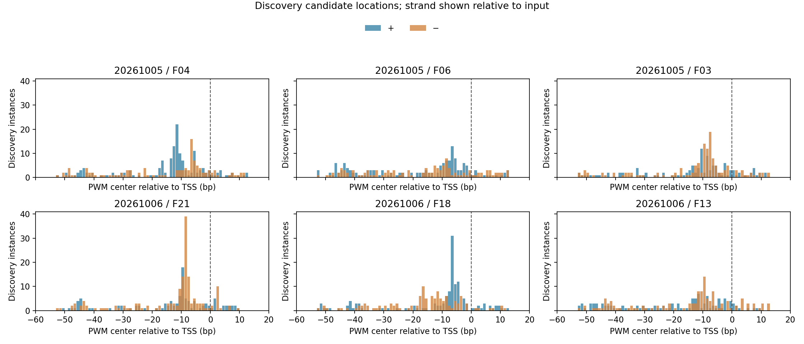

# 枯草芽孢杆菌真实数据：同一规则的候选比较

基于 MEME/STREME 使用的同一 TJU 冻结数据和划分，比较已有 STREME 自然对照运行的完整10个候选、CNN 平移候选、One-hot 与 ProkBERT 候选。CNN、One-hot、BERT 各2个种子，STREME为1次既有运行；不重新训练。

所有候选按 Discovery 正类与天然负类的同源组命中差排序，使用共同的天然对照90%分位阈值和双链PWM扫描；下表各取前5个候选，以候选集合至少命中一次计组。天然负类与配对 Shuffle 分开；正类66组、天然对照77组，Shuffle与66组正类配对。图中柱表示已有种子的均值、黑点表示每次运行；这两个种子共享数据，不是两份独立数据。

| 方法 | 种子 | 正类 | 天然对照 | 差值 | 配对 Shuffle |
| --- | --- | ---: | ---: | ---: | ---: |
| STREME | existing | 0.864 | 0.403 | +0.461 | 0.788 |
| CNN_SHIFT | 20261005 | 0.894 | 0.481 | +0.413 | 0.712 |
| ONEHOT | 20261005 | 0.758 | 0.312 | +0.446 | 0.712 |
| PROKBERT | 20261005 | 0.621 | 0.273 | +0.348 | 0.621 |
| CNN_SHIFT | 20261006 | 0.909 | 0.312 | +0.597 | 0.803 |
| ONEHOT | 20261006 | 0.818 | 0.468 | +0.351 | 0.773 |
| PROKBERT | 20261006 | 0.652 | 0.182 | +0.470 | 0.621 |

各方法均有较高的 Shuffle 命中，合并多个候选也会提高对照命中，因此需同时看正类与背景。完整候选池和配对正类/Shuffle仅一方命中的组数见 [family.tsv](family.tsv)；单个候选见 [candidates.tsv](candidates.tsv)。CNN使用序列级监督，其他候选产生过程不同；既有 Development 已观察，此表是探索性同数据比较。MEME完整 PWM 当前缺失，尚未纳入。

## CNN 候选位置与 STREME 局部相似

图中为各 CNN Discovery 排名前3个候选的训练实例中心，横轴相对 TSS；正负方向相对已标准化输入。它描述拟合时选中的位置，不是独立定位准确率。

每种子前5个 CNN 候选与同批 STREME 全部10个候选比较，允许正反向和偏移，最短重叠为较短 PWM 的60%且至少5 bp。最佳相似度和重叠长度见 [cnn_streme_similarity.tsv](cnn_streme_similarity.tsv)，这些 STREME 候选来自同一数据，仅用于描述性参照。

[Discovery 排序](discovery_rankings.tsv)｜[位置计数](cnn_discovery_positions.tsv)｜[来源与输出哈希](manifest.json)｜[方案](../README.md)。未使用真实 Holdout；未做新的生物功能验证。
