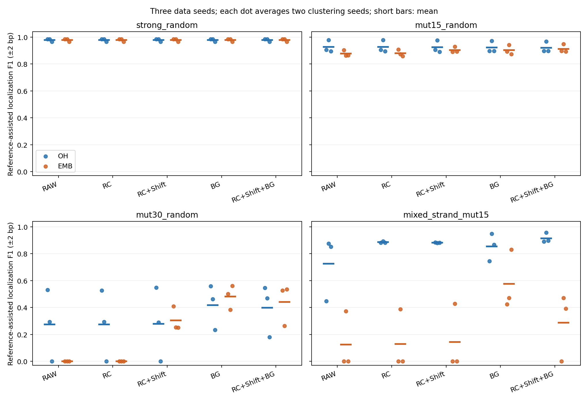

# 候选片段对齐与背景拒绝：阶段实验报告

日期：2026-10-26。协议：EMB-fragment-refinement-20261026-v1。范围：新的合成方法小试，未进入真实数据或功能验证。

## 实际执行

4条件×3个全新数据种子×2个聚类种子，One-hot与Frozen ProkBERT局部有序表示均执行相同5种候选后处理。实际48次聚类拟合，240组PWM输出；同一聚类产生多个对照，不把后处理重复算作新拟合。

每条件Discovery256、Development128、Test128条植入序列，各配同数空白；另有独立校准空白256条。81bp序列、12bp连续人工模式与12bp窗口，局部上下文24bp。3个数据种子是202610260/261/262，未复用前两轮Test。每个数据种子先平均2个聚类种子，再汇总3组数据；范围为数据均值min/max，不是置信区间，不把6次运行当6个独立样本。

协议与参与发现的算法源码在任何新Test评分前冻结并提交Git。所有发现输出先锁定，再统一评价Development/Test。未根据本轮Test改变方法、门槛或候选；真实Holdout始终未使用。与前两轮数据和随机种子不同，应看本轮同条件RAW对照，不能把跨轮均值拼成连续提升曲线。

## 本轮结论与下一步

1. **相对本轮BERT原流程，背景拒绝有实质改善。** 30%退化中，RAW为0，BG_ONLY约0.482；3个数据种子的均值分别约0.501/0.384/0.560，6次聚类运行均通过严格参考门槛。它改善的是候选实例/PWM构建流程，BERT权重没有训练。
2. **没有证明稳定优于One-hot。** 同一BG_ONLY处理，One-hot均值约0.418，但BERT仅1/3数据种子更好；逐种子差值约−0.056、−0.078、+0.326，均值优势由第三组较大的差异带动。BERT保留约7.8个候选、One-hot约6.5个，候选预算亦不同；BERT整个候选集的空白误报约0.263，高于One-hot约0.211。
3. **对齐不是普遍有效的默认组合。** BERT的30%退化RC_SHIFT约0.304、RC_SHIFT_BG约0.441，均值不及BG_ONLY约0.482。混合反向链中，BERT RAW约0.124，BG_ONLY提高到约0.574，但RC_SHIFT_BG约0.288；相同BG_ONLY的One-hot约0.853，RC_SHIFT_BG约0.914。后处理对齐仍未解决BERT的方向混合短板。
4. **较轻退化和强模式没有建立额外发现优势。** 15%退化，BERT RAW约0.877，RC_SHIFT_BG约0.913；相同组合One-hot约0.920。强模式双方各处理均约0.978。只展示BERT相对自身的改善会漏掉同样后处理的简单基线。
5. **误报下降需要和恢复率、候选数一起看。** 30%退化BERT BG_ONLY的候选集空白误报从RAW约0.667降到0.263，同时候选数从24降到约7.8。恢复F1也提高，说明并非只有空删候选；但误报改善的一部分与候选数减少有关，不能当正式FDR控制或BERT特有收益。
6. **下一步只把BG_ONLY作为待确认候选。** 建议另开版本，用至少5个新数据种子、多聚类种子及匹配候选预算复核；补更强One-hot设置和可用的STREME基线。BG_ONLY尚不直接升级为正式默认，不继续盲目叠加对齐；若要解决方向问题，应先研究聚类前的局部方向表示或更合理的实例分组。真实数据、SAE、微调和更换模型继续后置。

## 五组受控处理

- RAW：原最近窗口直接构建PWM。
- RC_ONLY：仅允许候选片段反向互补。
- RC_SHIFT：候选片段可反向互补及相对原位置±2bp移动；偏移不累计，不越界。
- BG_ONLY：RAW候选的Discovery空白最大分95百分位作固定门槛，拒绝低分已选实例。
- RC_SHIFT_BG：对RC_SHIFT作同样背景拒绝。

各处理共用同一PCA、聚类分配、距离及每簇每序列的最近原始窗口。对齐初始化使用距簇中心最近的实际DNA片段，固定3轮，以Discovery空白组成的零阶log odds评分并从当前片段重建PWM，伪计数0.5。没有使用已知PWM、人工植入位置或方向。移动后的窗口不重新编码/聚类，因此这属于**候选片段后处理**。

BG门槛来自Discovery空白，不是Test或最终校准空白；严格score>threshold，至少20条实例才重建候选PWM，只执行一次筛选、不再调门槛。它是聚类后的实例拒绝，不是新的允许噪声类别的聚类算法。父序列和TSS标准化方向不改；RC只体现在候选片段及其方向字段。

BERT权重继续冻结，128维只是一项预先选定的候选设置，不宣称最佳。One-hot独立PCA24；双方全部后处理规则相同。如果两者一起改善，不能把增益归为BERT特有能力。

## 新Test定位结果

主指标沿用全12列参考cosine≥0.8、方向正确、起点误差≤2bp的参考辅助定位F1。校准阈值来自独立合成空白每序列最大分95百分位，严格大于。参考仅用于评价时匹配候选，未进入发现；这不是无监督绝对precision，也不是FIMO位点p/q。未过门槛记0不等于hidden state无信息。

| representation | variant | strong_random | mut15_random | mut30_random | mixed_strand_mut15 |
| --- | --- | --- | --- | --- | --- |
| OH | RAW | 0.978 [0.966, 0.985] | 0.926 [0.894, 0.979] | 0.274 [0.000, 0.531] | 0.724 [0.446, 0.875] |
| OH | RC_ONLY | 0.978 [0.966, 0.985] | 0.926 [0.894, 0.979] | 0.273 [0.000, 0.526] | 0.885 [0.881, 0.893] |
| OH | RC_SHIFT | 0.978 [0.966, 0.985] | 0.924 [0.890, 0.977] | 0.279 [0.000, 0.548] | 0.881 [0.879, 0.883] |
| OH | BG_ONLY | 0.978 [0.966, 0.985] | 0.922 [0.896, 0.971] | 0.418 [0.234, 0.558] | 0.853 [0.744, 0.947] |
| OH | RC_SHIFT_BG | 0.978 [0.966, 0.985] | 0.920 [0.896, 0.967] | 0.398 [0.181, 0.545] | 0.914 [0.890, 0.955] |
| EMB | RAW | 0.978 [0.966, 0.985] | 0.877 [0.863, 0.904] | 0.000 [0.000, 0.000] | 0.124 [0.000, 0.372] |
| EMB | RC_ONLY | 0.978 [0.966, 0.985] | 0.880 [0.858, 0.908] | 0.000 [0.000, 0.000] | 0.129 [0.000, 0.387] |
| EMB | RC_SHIFT | 0.978 [0.966, 0.985] | 0.904 [0.890, 0.929] | 0.304 [0.250, 0.409] | 0.143 [0.000, 0.428] |
| EMB | BG_ONLY | 0.978 [0.966, 0.985] | 0.903 [0.874, 0.942] | 0.482 [0.384, 0.560] | 0.574 [0.423, 0.830] |
| EMB | RC_SHIFT_BG | 0.978 [0.966, 0.985] | 0.913 [0.893, 0.948] | 0.441 [0.263, 0.534] | 0.288 [0.000, 0.472] |



## 同数据种子的变化

下表比较每种后处理与同表示RAW的配对差值，完整逐种子表见 `paired_delta_vs_RAW.tsv`；BERT与相同处理One-hot的差值见 `paired_EMB_vs_OH.tsv`。不只展示最好的变体或数据种子。

| scenario | representation | variant | mean_delta_vs_RAW | data_seeds_improved | data_seeds |
| --- | --- | --- | --- | --- | --- |
| mixed_strand_mut15 | EMB | RC_ONLY | 0.005 | 1 | 3 |
| mixed_strand_mut15 | EMB | RC_SHIFT | 0.019 | 1 | 3 |
| mixed_strand_mut15 | EMB | BG_ONLY | 0.450 | 3 | 3 |
| mixed_strand_mut15 | EMB | RC_SHIFT_BG | 0.164 | 2 | 3 |
| mixed_strand_mut15 | OH | RC_ONLY | 0.161 | 3 | 3 |
| mixed_strand_mut15 | OH | RC_SHIFT | 0.156 | 3 | 3 |
| mixed_strand_mut15 | OH | BG_ONLY | 0.128 | 3 | 3 |
| mixed_strand_mut15 | OH | RC_SHIFT_BG | 0.190 | 3 | 3 |
| mut15_random | EMB | RC_ONLY | 0.003 | 2 | 3 |
| mut15_random | EMB | RC_SHIFT | 0.027 | 2 | 3 |
| mut15_random | EMB | BG_ONLY | 0.026 | 2 | 3 |
| mut15_random | EMB | RC_SHIFT_BG | 0.036 | 2 | 3 |
| mut15_random | OH | RC_ONLY | 0.000 | 0 | 3 |
| mut15_random | OH | RC_SHIFT | -0.002 | 0 | 3 |
| mut15_random | OH | BG_ONLY | -0.004 | 1 | 3 |
| mut15_random | OH | RC_SHIFT_BG | -0.005 | 1 | 3 |
| mut30_random | EMB | RC_ONLY | 0.000 | 0 | 3 |
| mut30_random | EMB | RC_SHIFT | 0.304 | 3 | 3 |
| mut30_random | EMB | BG_ONLY | 0.482 | 3 | 3 |
| mut30_random | EMB | RC_SHIFT_BG | 0.441 | 3 | 3 |
| mut30_random | OH | RC_ONLY | -0.001 | 0 | 3 |
| mut30_random | OH | RC_SHIFT | 0.004 | 1 | 3 |
| mut30_random | OH | BG_ONLY | 0.143 | 3 | 3 |
| mut30_random | OH | RC_SHIFT_BG | 0.124 | 3 | 3 |
| strong_random | EMB | RC_ONLY | 0.000 | 0 | 3 |
| strong_random | EMB | RC_SHIFT | 0.000 | 0 | 3 |
| strong_random | EMB | BG_ONLY | 0.000 | 0 | 3 |
| strong_random | EMB | RC_SHIFT_BG | 0.000 | 0 | 3 |
| strong_random | OH | RC_ONLY | 0.000 | 0 | 3 |
| strong_random | OH | RC_SHIFT | 0.000 | 0 | 3 |
| strong_random | OH | BG_ONLY | 0.000 | 0 | 3 |
| strong_random | OH | RC_SHIFT_BG | 0.000 | 0 | 3 |

分步增量另列，避免把组合处理的效果全部归给方向、偏移或拒绝中的某一项。它们仍是描述性配对差值，不是正式显著性检验。

| scenario | representation | contrast | mean_delta | positive_data_seeds | negative_data_seeds | data_seeds |
| --- | --- | --- | --- | --- | --- | --- |
| mixed_strand_mut15 | EMB | RC_ONLY minus RAW | 0.005 | 1 | 0 | 3 |
| mixed_strand_mut15 | EMB | RC_SHIFT minus RC_ONLY | 0.014 | 1 | 0 | 3 |
| mixed_strand_mut15 | EMB | BG_ONLY minus RAW | 0.450 | 3 | 0 | 3 |
| mixed_strand_mut15 | EMB | RC_SHIFT_BG minus RC_SHIFT | 0.145 | 2 | 0 | 3 |
| mixed_strand_mut15 | OH | RC_ONLY minus RAW | 0.161 | 3 | 0 | 3 |
| mixed_strand_mut15 | OH | RC_SHIFT minus RC_ONLY | -0.004 | 1 | 2 | 3 |
| mixed_strand_mut15 | OH | BG_ONLY minus RAW | 0.128 | 3 | 0 | 3 |
| mixed_strand_mut15 | OH | RC_SHIFT_BG minus RC_SHIFT | 0.033 | 3 | 0 | 3 |
| mut15_random | EMB | RC_ONLY minus RAW | 0.003 | 2 | 1 | 3 |
| mut15_random | EMB | RC_SHIFT minus RC_ONLY | 0.024 | 2 | 1 | 3 |
| mut15_random | EMB | BG_ONLY minus RAW | 0.026 | 2 | 1 | 3 |
| mut15_random | EMB | RC_SHIFT_BG minus RC_SHIFT | 0.009 | 2 | 0 | 3 |
| mut15_random | OH | RC_ONLY minus RAW | 0.000 | 0 | 0 | 3 |
| mut15_random | OH | RC_SHIFT minus RC_ONLY | -0.002 | 0 | 2 | 3 |
| mut15_random | OH | BG_ONLY minus RAW | -0.004 | 1 | 2 | 3 |
| mut15_random | OH | RC_SHIFT_BG minus RC_SHIFT | -0.003 | 1 | 2 | 3 |
| mut30_random | EMB | RC_ONLY minus RAW | 0.000 | 0 | 0 | 3 |
| mut30_random | EMB | RC_SHIFT minus RC_ONLY | 0.304 | 3 | 0 | 3 |
| mut30_random | EMB | BG_ONLY minus RAW | 0.482 | 3 | 0 | 3 |
| mut30_random | EMB | RC_SHIFT_BG minus RC_SHIFT | 0.137 | 3 | 0 | 3 |
| mut30_random | OH | RC_ONLY minus RAW | -0.001 | 0 | 1 | 3 |
| mut30_random | OH | RC_SHIFT minus RC_ONLY | 0.006 | 1 | 1 | 3 |
| mut30_random | OH | BG_ONLY minus RAW | 0.143 | 3 | 0 | 3 |
| mut30_random | OH | RC_SHIFT_BG minus RC_SHIFT | 0.120 | 2 | 1 | 3 |
| strong_random | EMB | RC_ONLY minus RAW | 0.000 | 0 | 0 | 3 |
| strong_random | EMB | RC_SHIFT minus RC_ONLY | 0.000 | 0 | 0 | 3 |
| strong_random | EMB | BG_ONLY minus RAW | 0.000 | 0 | 0 | 3 |
| strong_random | EMB | RC_SHIFT_BG minus RC_SHIFT | 0.000 | 0 | 0 | 3 |
| strong_random | OH | RC_ONLY minus RAW | 0.000 | 0 | 0 | 3 |
| strong_random | OH | RC_SHIFT minus RC_ONLY | 0.000 | 0 | 0 | 3 |
| strong_random | OH | BG_ONLY minus RAW | 0.000 | 0 | 0 | 3 |
| strong_random | OH | RC_SHIFT_BG minus RC_SHIFT | 0.000 | 0 | 0 | 3 |

## 整个候选集合的空白误报与候选保留

以下为Test空白中“任一候选超过自己的固定阈值”的比例，不受参考匹配门槛过滤。它是候选集合经验误报率，不是正式多重检验FDR。每候选的误报另见 `candidate_null_fpr.tsv`。

| scenario | representation | variant | family_fpr | candidate_count |
| --- | --- | --- | --- | --- |
| mixed_strand_mut15 | EMB | BG_ONLY | 0.289 | 12.333 |
| mixed_strand_mut15 | EMB | RAW | 0.600 | 24.000 |
| mixed_strand_mut15 | EMB | RC_ONLY | 0.621 | 24.000 |
| mixed_strand_mut15 | EMB | RC_SHIFT | 0.641 | 24.000 |
| mixed_strand_mut15 | EMB | RC_SHIFT_BG | 0.288 | 12.333 |
| mixed_strand_mut15 | OH | BG_ONLY | 0.314 | 11.333 |
| mixed_strand_mut15 | OH | RAW | 0.637 | 24.000 |
| mixed_strand_mut15 | OH | RC_ONLY | 0.622 | 24.000 |
| mixed_strand_mut15 | OH | RC_SHIFT | 0.629 | 24.000 |
| mixed_strand_mut15 | OH | RC_SHIFT_BG | 0.309 | 11.833 |
| mut15_random | EMB | BG_ONLY | 0.276 | 10.833 |
| mut15_random | EMB | RAW | 0.624 | 24.000 |
| mut15_random | EMB | RC_ONLY | 0.616 | 24.000 |
| mut15_random | EMB | RC_SHIFT | 0.641 | 24.000 |
| mut15_random | EMB | RC_SHIFT_BG | 0.275 | 11.167 |
| mut15_random | OH | BG_ONLY | 0.361 | 12.333 |
| mut15_random | OH | RAW | 0.659 | 24.000 |
| mut15_random | OH | RC_ONLY | 0.650 | 24.000 |
| mut15_random | OH | RC_SHIFT | 0.633 | 24.000 |
| mut15_random | OH | RC_SHIFT_BG | 0.341 | 12.167 |
| mut30_random | EMB | BG_ONLY | 0.263 | 7.833 |
| mut30_random | EMB | RAW | 0.667 | 24.000 |
| mut30_random | EMB | RC_ONLY | 0.667 | 24.000 |
| mut30_random | EMB | RC_SHIFT | 0.656 | 24.000 |
| mut30_random | EMB | RC_SHIFT_BG | 0.284 | 8.167 |
| mut30_random | OH | BG_ONLY | 0.211 | 6.500 |
| mut30_random | OH | RAW | 0.685 | 24.000 |
| mut30_random | OH | RC_ONLY | 0.694 | 24.000 |
| mut30_random | OH | RC_SHIFT | 0.694 | 24.000 |
| mut30_random | OH | RC_SHIFT_BG | 0.214 | 6.500 |
| strong_random | EMB | BG_ONLY | 0.344 | 14.000 |
| strong_random | EMB | RAW | 0.566 | 24.000 |
| strong_random | EMB | RC_ONLY | 0.572 | 24.000 |
| strong_random | EMB | RC_SHIFT | 0.616 | 24.000 |
| strong_random | EMB | RC_SHIFT_BG | 0.335 | 13.500 |
| strong_random | OH | BG_ONLY | 0.354 | 14.667 |
| strong_random | OH | RAW | 0.658 | 24.000 |
| strong_random | OH | RC_ONLY | 0.635 | 24.000 |
| strong_random | OH | RC_SHIFT | 0.647 | 24.000 |
| strong_random | OH | RC_SHIFT_BG | 0.345 | 14.500 |

背景拒绝会改变候选数量。若误报下降却同时丢掉可恢复模式，不能只据误报降低称改进成功；零候选的误报为0，但召回也为0。对齐可能把随机片段拼成较保守PWM，只有独立Test恢复与空白评价才能检验是否有实际价值。

## 结果解释边界

本轮只有3个数据种子、2个聚类种子，是新后处理的有界小试，不作总体优劣、稳定提升或新功能motif主张。未运行替代聚类算法、SAE、微调或新编码器。STREME传统基线仍未补齐，不能宣称总体胜过传统方法。后续若依据这些Test结果改方法，另开版本并换Test种子。

## 核验与资源

28项相关测试通过。688项产物哈希、980912条实例坐标/方向记录核查通过，其中反向片段71454条、偏移片段75479条；6144条植入真值核查通过。2644个历史保护文件哈希不变，覆盖冻结v2和前两轮证据。哈希核验不等于独立重跑历史实验；没有全量近同源重审计。

另从保存的实例表独立重建4536个PWM，核对父序列边界、方向、每候选每序列至多一个实例，并检查96组BG实例为对应源实例子集，见 `independent_qa.json`。这属于保存产物一致性，不等于独立重拟合模型。

CPU4线程，无GPU。主拟合约1316.8秒，含共享编码、PCA、聚类与后处理，不将共享成本当每方法独立端到端成本。环境、固定ProkBERT版本与无缺失权重加载见 `manifest.json` 和 `encoder.json`。模型/特征/人工序列/逐实例/拟合对象保留本地，公开协议、源码、汇总、图表、失败结果及哈希。

## 复现

```powershell
python -m experiments.pr01_02_embedding_v2.refinement_20261026.pipeline fit
python -m experiments.pr01_02_embedding_v2.refinement_20261026.pipeline score
python -m experiments.pr01_02_embedding_v2.refinement_20261026.pipeline verify
python -m experiments.pr01_02_embedding_v2.refinement_20261026.qa
python -m experiments.pr01_02_embedding_v2.refinement_20261026.report
```

拟合拒绝覆盖已有目录，重跑用新checkout或新版本。不能删除已有阴性结果重新挑选输出。
