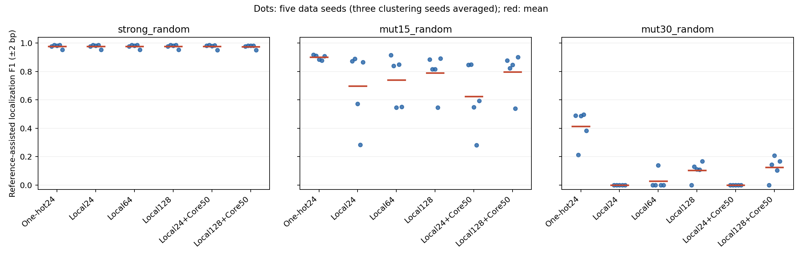
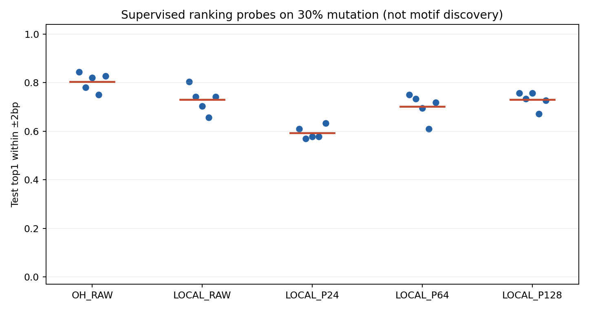

# 有序局部表示复核与PCA/实例瓶颈：阶段报告

日期：2026-10-25。协议：EMB-validation-20261025-v1。状态：本轮合成复核、消融、压力测试及定位探针完成；未进入真实数据与功能验证。

## 实际执行与证据边界

主实验3难度×5全新数据种子×3聚类种子，6种发现配置；另3种压力条件各2数据种子×3聚类种子×3配置。主矩阵完成234次实际聚类、324组PWM输出。CORE50复用聚类，不重复算拟合。另以原版fit函数完成90次原流程复核，合计324次实际聚类、414组发现输出。监督定位探针25个，单独统计。

先冻结协议和源码、拟合并锁定全部PWM，再读取Test评价；未依据本轮Test修改任何发现方法、门槛或候选。原流程复核也有独立协议、fit lock与源码哈希。上一轮Test不复用。真实Holdout未启用，未新增功能motif结论。

每条件Discovery256、Development128、Test128条植入序列，各配同数空白，另校准空白256条。序列81bp，人工连续模式和核心窗口均12bp；不代表真实−35/−10间距结构。压力条件是GC=.75强模式、一阶持续性=.7相关背景强模式、50%概率反向链的15%退化模式。生成时核验分区内/间无exact/RC重复，未执行全量近同源审计。

## 可比性与统计单位

局部编码仍是固定ProkBERT-mini的L6，24bp上下文、核心7个6-mer hidden states按位置拼接。每条序列70个窗口对应58个不同裁剪，复用边缘裁剪只减少重复计算，坐标核验不变。

PCA消融固定一个Discovery PCA128基底，取前24/64/128维，固定PCA种子；只改变KMeans种子。CORE50使用同一批聚类分配，在每簇按Discovery距离中位数保留窗口，再每序列取最近窗口，至少20条形成PWM，不使用植入真值。没有进行片段偏移/反向互补对齐。

另列上一轮原流程复核：直接调用未修改的 `bottleneck_20261025.pilot.fit`，每个算法种子重新拟合PCA24与KMeans；One-hot与有序局部表示均跑。这样避免把新的嵌套PCA计算路径误称为原流程逐项复现。裁剪batch96与历史64不同，不主张编码结果逐字节一致。

主统计**先平均同一数据种子内的3个聚类运行，再汇总5个数据种子**；不是15个独立样本。压力测试仅两个数据种子，只描述。以下范围是5个数据均值的min/max，不是置信区间。

## 本轮已能支持的结论

1. **上一轮约0.900的15%退化结果尚未稳定复现。** 原计算流程扩大到5数据种子×3算法种子后，局部有序表示均值约0.695，One-hot约0.901；局部表示12/15次运行通过参考门槛，不能只报告成功运行的高分。强模式两者均约0.976；30%退化局部表示仍全部未过门槛。One-hot在30%退化也有部分算法运行失败，说明随机发现流程的问题并非Embedding独有。
2. **PCA维度是一个影响环节，但不是完整解释。** 在共用基底的受控消融中，15%退化从24维约0.697提高到128维约0.790，5个数据种子中4个改善；仍低于One-hot约0.900。30%退化从0提高到约0.103，仍低于One-hot约0.413。更高保留方差本身不是模式信息充分的证明。
3. **固定距离筛选没有形成普遍提升。** CORE50使24维15%退化约0.697降到0.624；128维则约0.790到0.797，30%退化约0.103到0.124。不同配置方向不一致，不能把它作为已验证有效的默认改进。
4. **主要短板包括退化信号与方向混合。** 高GC与Markov强模式表现接近One-hot；混合反向链15%退化时，局部24维为0、128维约0.387，One-hot约0.890。后者仅2数据种子，且未做片段方向对齐，只能作为流程问题的证据线索。
5. **可读信息仍在，单纯换模型缺乏依据。** 30%退化的监督top1±2bp定位率均值：原始局部表示约0.730、PCA24约0.594、PCA64约0.702、PCA128约0.730，One-hot约0.805。信息并未完全消失，强降维会影响监督可读性；而PCA128的无监督PWM恢复仍弱，提示聚类和实例构建也值得优先研究。探针与PWM使用不同训练信号/指标，不能相减计算“损失比例”，更不能把探针算作发现成功。
6. **下一轮优先改发现与实例对齐，暂不进入真实数据、不扩大模型规模。** 建议用新的合成Test版本，先对实际候选片段做反向互补/偏移对齐的单因素对照，再检查允许拒绝背景窗口的聚类或局部相似度策略；One-hot同样执行对照。128维只是后续候选设置，不是已确定最佳维度。候选片段方向对齐与对整条TSS标准化序列翻链严格区分，不能改写冻结数据方向处理。弱模式、方向鲁棒性及传统基线未闭合前，不启动真实拟合、SAE或微调。

## 原流程复核

| scenario | method | f1_mean | f1_data_min | f1_data_max | success_fraction |
| --- | --- | --- | --- | --- | --- |
| mut15_random | LOCAL_RECIPE_P24 | 0.695 | 0.552 | 0.894 | 0.800 |
| mut15_random | OH_RECIPE_P24 | 0.901 | 0.868 | 0.919 | 1.000 |
| mut30_random | LOCAL_RECIPE_P24 | 0.000 | 0.000 | 0.000 | 0.000 |
| mut30_random | OH_RECIPE_P24 | 0.360 | 0.336 | 0.391 | 0.667 |
| strong_random | LOCAL_RECIPE_P24 | 0.976 | 0.952 | 0.985 | 1.000 |
| strong_random | OH_RECIPE_P24 | 0.976 | 0.952 | 0.985 | 1.000 |

## PCA与实例筛选主实验

| method | strong_random | mut15_random | mut30_random |
| --- | --- | --- | --- |
| OH_P24 | 0.976 [0.952, 0.985] | 0.900 [0.877, 0.918] | 0.413 [0.213, 0.496] |
| LOCAL_P24 | 0.976 [0.952, 0.985] | 0.697 [0.284, 0.889] | 0.000 [0.000, 0.000] |
| LOCAL_P64 | 0.976 [0.952, 0.985] | 0.740 [0.546, 0.916] | 0.028 [0.000, 0.140] |
| LOCAL_P128 | 0.976 [0.952, 0.985] | 0.790 [0.545, 0.890] | 0.103 [0.000, 0.168] |
| LOCAL_P24_CORE50 | 0.976 [0.950, 0.985] | 0.624 [0.280, 0.849] | 0.000 [0.000, 0.000] |
| LOCAL_P128_CORE50 | 0.975 [0.950, 0.982] | 0.797 [0.539, 0.900] | 0.124 [0.000, 0.208] |



每个数据种子相对One-hot的配对变化：

| scenario | method | mean_delta_vs_OH | data_seeds_better_than_OH | data_seeds |
| --- | --- | --- | --- | --- |
| strong_random | LOCAL_P24 | 0.000 | 0 | 5 |
| strong_random | LOCAL_P64 | 0.000 | 0 | 5 |
| strong_random | LOCAL_P128 | 0.000 | 0 | 5 |
| strong_random | LOCAL_P24_CORE50 | -0.000 | 1 | 5 |
| strong_random | LOCAL_P128_CORE50 | -0.001 | 0 | 5 |
| mut15_random | LOCAL_P24 | -0.203 | 0 | 5 |
| mut15_random | LOCAL_P64 | -0.160 | 0 | 5 |
| mut15_random | LOCAL_P128 | -0.110 | 0 | 5 |
| mut15_random | LOCAL_P24_CORE50 | -0.276 | 0 | 5 |
| mut15_random | LOCAL_P128_CORE50 | -0.103 | 0 | 5 |
| mut30_random | LOCAL_P24 | -0.413 | 0 | 5 |
| mut30_random | LOCAL_P64 | -0.385 | 0 | 5 |
| mut30_random | LOCAL_P128 | -0.310 | 0 | 5 |
| mut30_random | LOCAL_P24_CORE50 | -0.413 | 0 | 5 |
| mut30_random | LOCAL_P128_CORE50 | -0.289 | 0 | 5 |

所有算法运行、阈值门槛、参考cosine与TP/预测分母保留在 `summary/metrics.tsv`；逐数据种子表见 `per_data_seed.tsv`。主要F1要求全宽参考cosine≥.8、方向正确、起点误差≤2bp；未过参考门槛记0，不能推断hidden state完全无信息。参考辅助选最佳家族，不是无人监督实际precision。

## 压力条件

| scenario | method | f1_mean | f1_data_min | f1_data_max | data_seeds | success_fraction |
| --- | --- | --- | --- | --- | --- | --- |
| gc75_strong | LOCAL_P128 | 0.979 | 0.977 | 0.981 | 2 | 1.000 |
| gc75_strong | LOCAL_P24 | 0.981 | 0.981 | 0.982 | 2 | 1.000 |
| gc75_strong | OH_P24 | 0.979 | 0.977 | 0.981 | 2 | 1.000 |
| markov_strong | LOCAL_P128 | 0.990 | 0.985 | 0.996 | 2 | 1.000 |
| markov_strong | LOCAL_P24 | 0.990 | 0.985 | 0.996 | 2 | 1.000 |
| markov_strong | OH_P24 | 0.985 | 0.985 | 0.986 | 2 | 1.000 |
| mixed_strand_mut15 | LOCAL_P128 | 0.387 | 0.238 | 0.536 | 2 | 0.500 |
| mixed_strand_mut15 | LOCAL_P24 | 0.000 | 0.000 | 0.000 | 2 | 0.000 |
| mixed_strand_mut15 | OH_P24 | 0.890 | 0.876 | 0.903 | 2 | 1.000 |

混合反向链评价使用真实植入方向与PWM参考方向的组合，不能只按物理位置给TP。当前发现仍按正向窗口聚合，没有实例方向对齐，因此压力失败可指向流程短板，但不是单因素因果证明。

## 监督定位探针：30%退化

| representation | top1_within2_mean | top1_within2_min | top1_within2_max | exact_mean | data_seeds | max_iterations |
| --- | --- | --- | --- | --- | --- | --- |
| LOCAL_P128 | 0.730 | 0.672 | 0.758 | 0.706 | 5 | 23 |
| LOCAL_P24 | 0.594 | 0.570 | 0.633 | 0.539 | 5 | 12 |
| LOCAL_P64 | 0.702 | 0.609 | 0.750 | 0.691 | 5 | 18 |
| LOCAL_RAW | 0.730 | 0.656 | 0.805 | 0.708 | 5 | 63 |
| OH_RAW | 0.805 | 0.750 | 0.844 | 0.795 | 5 | 12 |



探针只在Discovery已知植入位置训练；每条序列1个准确核心窗和4个无重叠背景窗，StandardScaler加balanced LogisticRegression(C=1,max_iter=1000)。固定训练设置，Test只在全部无监督拟合锁定后编码，枚举70窗取最高分位置。报告Test植入正序列内top1定位率，没有空白检测/FPR评价，**不是无监督发现、不是生物学证据，也不能与上表PWM定位F1等同**。原始高维与PCA探针还受监督正则化、维度和样本量影响，不能仅凭差异证明单一因果。

## 跨聚类种子的描述性稳定性

| method | matched_pairs | pwm_cosine_median | instance_jaccard_median |
| --- | --- | --- | --- |
| LOCAL_P128 | 723 | 0.969 | 0.505 |
| LOCAL_P128_CORE50 | 702 | 0.973 | 0.538 |
| LOCAL_P24 | 696 | 0.958 | 0.430 |
| LOCAL_P24_CORE50 | 681 | 0.952 | 0.440 |
| LOCAL_P64 | 749 | 0.973 | 0.535 |
| OH_P24 | 423 | 0.996 | 0.693 |

全宽cosine≥.8的一对一匹配家族，报告PWM相似与实例精确起点Jaccard；包含背景家族，坐标不作方向对齐。高PWM相似不等于实例稳定，算法配对不是独立数据重复，不据此计算生物学显著性。

## 全候选空白误报

| tier | method | mean | min | max |
| --- | --- | --- | --- | --- |
| main | LOCAL_P128 | 0.049 | 0.000 | 0.141 |
| main | LOCAL_P128_CORE50 | 0.050 | 0.000 | 0.133 |
| main | LOCAL_P24 | 0.048 | 0.000 | 0.156 |
| main | LOCAL_P24_CORE50 | 0.048 | 0.000 | 0.141 |
| main | LOCAL_P64 | 0.048 | 0.000 | 0.141 |
| main | OH_P24 | 0.048 | 0.000 | 0.148 |
| stress | LOCAL_P128 | 0.041 | 0.000 | 0.133 |
| stress | LOCAL_P24 | 0.045 | 0.000 | 0.117 |
| stress | OH_P24 | 0.040 | 0.000 | 0.148 |

阈值为独立合成校准空白最大分95百分位，严格score>threshold；上述FPR包含未通过参考匹配的所有候选，不把失败候选藏掉。每候选单独校准，均值不等于整个候选家族误报率；不是FIMO位点p/q。

## 核验与资源

20项相关测试通过。1902项产物哈希、1778439条实例、10752条植入真值、376320次核心还原核查通过；460个历史保护文件不变。原流程复核输出另有独立 `replication_lock.json`，原fit源码哈希保留。哈希一致不等于独立重跑历史实验。

原流程复核另验收270项哈希和530979条片段。编码数值对照抽查6个Discovery序列、各70窗，对比历史batch64和本轮batch96/裁剪去重，抽样最大绝对误差为0；仅限抽样，不推断全量逐字节一致。

Python 3.13.5，Torch 2.7.1 CPU，Transformers 5.8.0，4线程，无GPU。主矩阵拟合约1331.4秒，后续评价、探针和复核分别执行，不将混合墙钟时间当单一方法成本。编码器revision/文件哈希与无缺失权重加载证据在 `summary/encoder.json`。

## 尚未闭合与真实数据门槛

当前环境无STREME、Docker或WSL发行版，见 `tool_availability.json`；没有用替代实现冒充STREME。传统基线未补齐，任何合成优势都不能直接写成总体胜过传统方法。片段偏移/方向对齐、可变宽度、更多人工模式、真实数据注释验证仍未执行。SAE、微调和更换编码器继续后置。

若依据本轮Test继续改方案，另开版本并更换Test种子。只有恢复能力、压力条件、实例稳定性及传统基线得到支持后，才考虑真实数据小试；真实Development已反复使用，项目Holdout曾被传统主线查看，均不能称为全新盲验证。

## 复现

```powershell
python -m experiments.pr01_02_embedding_v2.validation_20261025.pipeline fit
python -m experiments.pr01_02_embedding_v2.validation_20261025.replicate fit
python -m experiments.pr01_02_embedding_v2.validation_20261025.pipeline score
python -m experiments.pr01_02_embedding_v2.validation_20261025.replicate score
python -m experiments.pr01_02_embedding_v2.validation_20261025.pipeline probes
python -m experiments.pr01_02_embedding_v2.validation_20261025.pipeline verify
python -m experiments.pr01_02_embedding_v2.validation_20261025.replicate verify
python -m experiments.pr01_02_embedding_v2.validation_20261025.check_features
python -m experiments.pr01_02_embedding_v2.validation_20261025.report
```

拟合拒绝覆盖已有目录。重跑应使用新checkout或新版本。模型/特征/人工序列/实例/拟合对象留本地；公开配置、源码、汇总、图表、诊断与哈希。保护原始输入、旧结果和用户已有无关改动。
