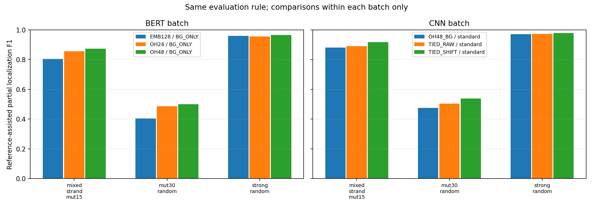

# 统一片段口径：已有合成实验的同批对照

2026-10-27。先对已有结果中数据与候选预算一致的部分进行比较；这是项目结果重构的阶段成果，真实数据的统一重扫及传统方法、BERT、CNN的同数据比较仍待完成。

## 评价口径

每次至多5个候选，沿用此前已计算的片段参考辅助定位：与12bp合成参考重叠至少8bp，考虑正反向和偏移，位置容差±3bp，不以相似度额外淘汰候选；最终F1同时考虑正样本定位与空白序列预测。先平均同一数据的算法种子，再对5组数据求均值。[逐数据结果](per_data_seed.tsv)｜[汇总](summary.tsv)｜[来源记录](manifest.json)。

这是对已观察过的Test和固定候选的事后探索，选择匹配候选时使用了合成参考。它适合展示局部候选及定位，不能解释为真实序列性能或不使用参考的自动发现能力。完整低值和对照记录均保留于明细；原实验和原报告未修改。

## 同批比较

| 实验批次 | 场景 | 方法及平均F1 | 平均空白误报 |
| --- | --- | --- | --- |
| BERT批次 | 混合链15%退化 | BERT 0.804；One-hot24 0.856；One-hot48 0.872 | 0.131；0.142；0.146 |
| BERT批次 | 30%退化 | BERT 0.403；One-hot24 0.487；One-hot48 0.499 | 0.163；0.163；0.146 |
| BERT批次 | 强模式 | BERT 0.959；One-hot24 0.955；One-hot48 0.965 | 0.140；0.143；0.144 |
| CNN批次 | 混合链15%退化 | One-hot48 0.880；CNN原窗口 0.889；CNN平移 0.918 | 0.113；0.110；0.064 |
| CNN批次 | 30%退化 | One-hot48 0.475；CNN原窗口 0.504；CNN平移 0.539 | 0.136；0.138；0.121 |
| CNN批次 | 强模式 | One-hot48 0.970；CNN原窗口 0.972；CNN平移 0.978 | 0.117；0.094；0.065 |

表中每批有3种场景、每场景5组数据。BERT使用背景拒绝版本，CNN是双向共享模型，CNN平移与原窗口采用同一模型。CNN的序列级监督与One-hot的训练信息不同。两批使用不同数据种子，故**只比较各批内部方法**，不按表中均值直接比较BERT和CNN。

## 待继续

- 在相同数据上补齐传统方法、BERT和CNN候选，并固定共同的候选预算与评价方法，才能形成跨线路的同批对照。
- 真实数据的传统FIMO与Embedding扫描目前阈值、单位及对照口径不同，不能把已有命中率直接视为统一得分；应统一扫描和背景后再计算。真实参考覆盖范围及共享来源也须明确。
- 项目全部候选和其他历史轮次见[候选总览](../practice_motif_20261027/REPORT.md)。
