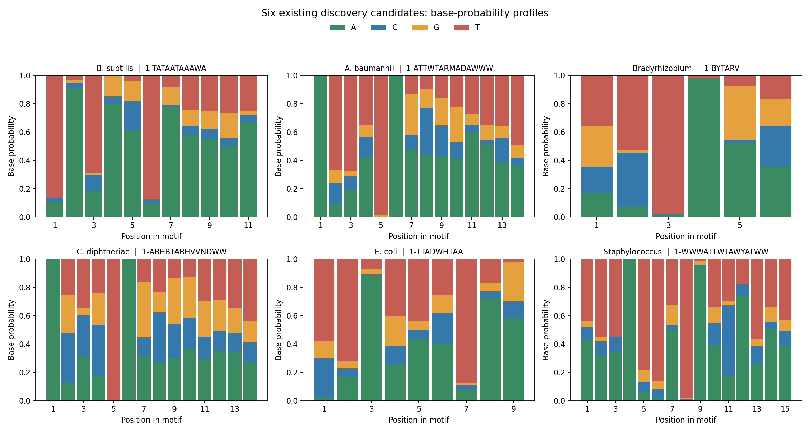
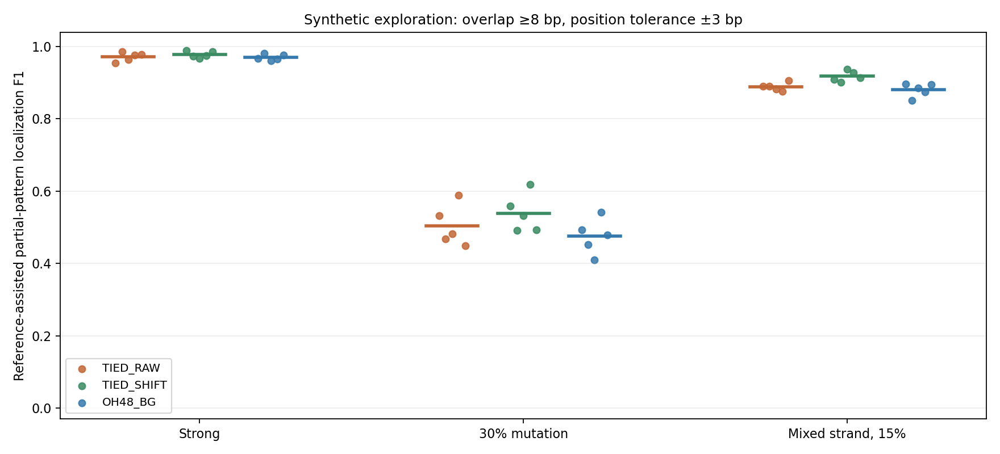

# 启动子 Motif 课程实践：候选与结果总览

整理日期：2026-10-27。当前目录把已有真实数据结果与合成方法实验集中展示，便于从来源、候选形状、对照和位置几个角度阅读。

## 浏览入口

- [交互式候选浏览](index.html)：按来源、方法或关键词筛选，查看 Development 正类/对照命中、既有 q 值与已保存 Logo。
- [传统方法候选表](traditional_candidates.tsv)：540条 MEME/STREME 运行级候选，含来源、组、背景、发现结果、Development命中及参考相似记录。
- [Embedding历史候选表](embedding_candidates.tsv)：1289条运行级候选/对照记录，分别保留天然和Shuffle结果；STREME对照在不同运行中重复出现，不算新的独立motif。
- [合成片段评价汇总](synthetic_partial_summary.tsv)｜[逐数据种子](synthetic_partial_per_data_seed.tsv)｜[全部评价记录](synthetic_partial_metrics.tsv)。

候选数是运行记录数，不是去重后的生物学功能motif数。两条真实数据路线的扫描方法、对照、q值家族不同，不把它们的q值当作相同指标。表中空值表示没有可用记录，不填零；已知参考相似仅作注释。

## 真实数据：候选分布

传统发现中实际记录540条PWM，覆盖TJU六物种、RegulonDB和DBTBS各可运行组、MEME与STREME；部分小样本组或辅助运行有既存限制，见[扩展结果原报告](../M3_扩展双方法与sigma实验_20261009.md)。原有17个自然对照主候选在表中有标记；这里另展示全部运行级候选。DBTBS与TJU有高度重叠，不计作独立外部验证。

| source | method | 运行级候选数 |
| --- | --- | --- |
| dbtbs_bsub | meme | 80 |
| dbtbs_bsub | streme | 80 |
| regulondb_ecoli | meme | 70 |
| regulondb_ecoli | streme | 70 |
| tjupan_bacillus_subtilis | meme | 20 |
| tjupan_bacillus_subtilis | streme | 20 |
| tjupan_baumannii | meme | 20 |
| tjupan_baumannii | streme | 20 |
| tjupan_bradyrhizobium | meme | 20 |
| tjupan_bradyrhizobium | streme | 20 |
| tjupan_diphtheria | meme | 20 |
| tjupan_diphtheria | streme | 20 |
| tjupan_escherichia_coli | meme | 20 |
| tjupan_escherichia_coli | streme | 20 |
| tjupan_staphylococcus | meme | 20 |
| tjupan_staphylococcus | streme | 20 |

每张图使用各物种Discovery阶段既有主候选中的第1个PWM；柱高是每个位置的A/C/G/T概率，并非功能强度。每个候选、完整PWM与原运行依据见传统方法表和历史结果。

## 真实数据：Embedding及对照

| method | 运行级记录数 |
| --- | --- |
| STREME | 152 |
| multiscale | 66 |
| onehot | 456 |
| prokbert | 436 |
| tokenwindow | 179 |

53个历史运行提供天然对照和配对Shuffle的Development聚合记录；每条记录展示正类/对照命中数、原始p、各自q及运行参数。天然对照和Shuffle含义不同，分别阅读；重复的STREME对照记录并非新发现。详情见[Embedding原报告](../../experiments/pr01_02_embedding_v2/REPORT.md)和[事实汇总](../../experiments/pr01_02_embedding_v2/facts_20261010/实验事实汇总_GitHub.md)。

## 合成实验：局部模式与位置

基于四轮已保存候选和锁定的预算集合，重新计算局部模式评价，共2400个候选集合、Development/Test各一行。已知人工参考只用于评价：在每个已冻结集合内寻找至少8/12bp重叠的最佳参考相似，考虑正反向和偏移，将参考起点投影后按±3bp统计定位F1；不按相似度额外筛掉候选。表中同时给出平均相似度、重叠长度、候选数量及整个候选集的空白误报；空集合保留0分。

这是一项使用已知参考和已看过的数据的事后探索：低相似度也有记录，F1不能单独视作motif真实性、真实数据性能或新的独立验证。各数据种子先平均同一数据的算法运行，再汇总数据种子；CNN使用序列级监督，One-hot聚类没有相同分类训练。

### 最新CNN合成轮次：CAP5

| scenario | representation | f1_mean | partial_cosine | overlap_bp | family_blank_fpr | budget | data_seeds |
| --- | --- | --- | --- | --- | --- | --- | --- |
| mixed_strand_mut15 | OH48_BG | 0.880 | 0.998 | 11.133 | 0.113 | 5.000 | 5 |
| mixed_strand_mut15 | TIED_RAW | 0.889 | 0.999 | 11.500 | 0.110 | 5.000 | 5 |
| mixed_strand_mut15 | TIED_SHIFT | 0.918 | 0.999 | 12.000 | 0.064 | 5.000 | 5 |
| mut30_random | OH48_BG | 0.475 | 0.995 | 11.000 | 0.136 | 5.000 | 5 |
| mut30_random | TIED_RAW | 0.504 | 0.992 | 11.567 | 0.138 | 5.000 | 5 |
| mut30_random | TIED_SHIFT | 0.539 | 0.991 | 12.000 | 0.121 | 5.000 | 5 |
| strong_random | OH48_BG | 0.970 | 1.000 | 10.300 | 0.117 | 5.000 | 5 |
| strong_random | TIED_RAW | 0.972 | 1.000 | 10.933 | 0.094 | 5.000 | 5 |
| strong_random | TIED_SHIFT | 0.978 | 1.000 | 11.933 | 0.065 | 5.000 | 5 |

每点表示1组数据中各算法种子的平均，横线为数据均值。更多轮次、预算和Development/Test结果可在TSV中按字段筛选。

## 使用说明

1. 先看候选的来源、背景和序列形状，再结合命中数、对照和已保存的统计值解释。
2. 真实序列候选、人工植入模式和参考相似度分别理解；不能把合成参考辅助定位结果写成真实启动子发现。
3. 本次没有重训模型、重跑FIMO或调整真实留出数据；如果后续根据这份探索结果修改算法，应另设运行和验证数据。既有科学结果、负面观察及工具失败记录仍可从原报告追溯。

所有输入和输出SHA256、处理配置及核验计数见 [manifest.json](manifest.json)。
