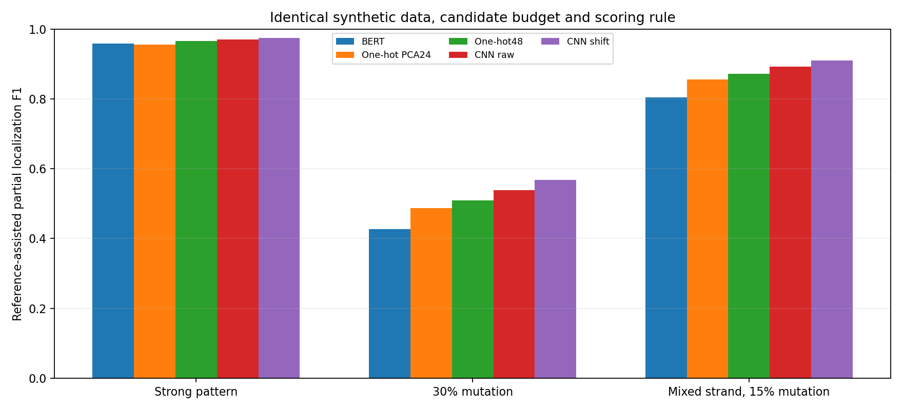

# 同一批合成数据：BERT、One-hot 与 CNN 的比较

本轮使用原BERT实验的同一批输入：3种场景×5个数据种子，每个数据种子下3个算法种子。BERT、One-hot沿用已保存的Discovery候选；CNN在同一批Discovery正类和空白序列上新训练，共45个模型，原窗口和平移共用模型。没有使用真实数据或重新训练BERT。

统一按Discovery正类与空白命中率差排序，每组数据和算法种子取各方法共同可用的候选数量，最多5个。合成评价使用已知参考，在候选集合内选最佳局部相似项：重叠至少8/12 bp，正反向及偏移均考虑，位置容差±3 bp；空白序列预测计入精确率，同时单列候选集合空白误报。算法种子先在每组数据内求平均，再汇总5组数据。

该批BERT和One-hot的Test结果在此前已观察，本轮CNN是在旧数据上追加的探索性同批对比；参考辅助选择候选，不等于参考无关的自动发现。CNN有序列级标签监督，BERT及One-hot聚类没有同样的分类训练。

| 场景 | 方法 | 平均F1 | 数据种子范围 | 空白误报 |
| --- | --- | ---: | ---: | ---: |
| strong_random | BERT | 0.959 | 0.942–0.980 | 0.140 |
| strong_random | One-hot PCA24 | 0.955 | 0.941–0.973 | 0.143 |
| strong_random | One-hot48 | 0.965 | 0.946–0.973 | 0.144 |
| strong_random | CNN raw | 0.970 | 0.955–0.992 | 0.111 |
| strong_random | CNN shift | 0.974 | 0.955–0.992 | 0.073 |
| mut30_random | BERT | 0.427 | 0.377–0.491 | 0.155 |
| mut30_random | One-hot PCA24 | 0.487 | 0.397–0.607 | 0.163 |
| mut30_random | One-hot48 | 0.509 | 0.398–0.591 | 0.139 |
| mut30_random | CNN raw | 0.538 | 0.495–0.571 | 0.142 |
| mut30_random | CNN shift | 0.568 | 0.495–0.655 | 0.128 |
| mixed_strand_mut15 | BERT | 0.804 | 0.780–0.830 | 0.131 |
| mixed_strand_mut15 | One-hot PCA24 | 0.856 | 0.821–0.887 | 0.142 |
| mixed_strand_mut15 | One-hot48 | 0.872 | 0.836–0.909 | 0.146 |
| mixed_strand_mut15 | CNN raw | 0.892 | 0.874–0.907 | 0.094 |
| mixed_strand_mut15 | CNN shift | 0.909 | 0.887–0.931 | 0.069 |

逐数据种子配对差值（CNN平移−BERT）用于显示数据间变化：

| 场景 | 平均差值 | 正/负/平 |
| --- | ---: | --- |
| strong_random | +0.015 | 5/0/0 |
| mut30_random | +0.141 | 5/0/0 |
| mixed_strand_mut15 | +0.106 | 5/0/0 |

[逐次运行](runs.tsv)｜[逐数据种子](per_data_seed.tsv)｜[汇总](summary.tsv)｜[来源与校验](manifest.json)。候选不足5个及低分均保留。

传统MEME/STREME没有在这批合成数据上运行，本机当前未找到可用的MEME Suite，因此没有填入或借用其他数据的分数。真实数据的统一扫描另待完成。
