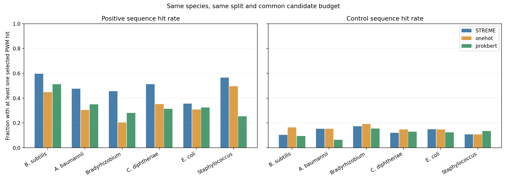

# 六物种真实数据：同批候选统一扫描

比较已有STREME主候选、One-hot和ProkBERT候选，使用同一物种、同一Discovery/Development划分和相同天然对照。每个物种按三种方法所有运行中共同可用的候选数取相同数量，最多5个；因此不同物种的共同数量可以不同。STREME为1次既有候选集，One-hot与ProkBERT各为3个种子、L6W10。

统一在Discovery的天然对照上确定每个PWM的95百分位扫描阈值，双向扫描；候选按Discovery正类命中率减对照命中率排序，信息量和名称用于平局排序。对Development序列，统计候选集合至少命中一次的正类及对照比例。图中对照命中不是可以忽略的噪声：应与正类命中一起阅读。

这是对已有候选及已观察过的Development数据进行的事后探索。STREME候选是原有已筛选主候选，Embedding候选来自各运行的完整PWM池；候选产生与初筛方式不同。结果不等于准确率或功能验证。CNN和MEME尚没有在这批真实数据上按此方案生成可比较的候选，故不在表中虚填。

| 物种 | 方法 | 共同候选数 | 正类命中率 | 对照命中率 | 差值 |
| --- | --- | ---: | ---: | ---: | ---: |
| B. subtilis | STREME | 3 | 0.597 | 0.104 | +0.493 |
| B. subtilis | onehot | 3 | 0.448 | 0.165 | +0.283 |
| B. subtilis | prokbert | 3 | 0.512 | 0.095 | +0.417 |
| A. baumannii | STREME | 2 | 0.475 | 0.154 | +0.321 |
| A. baumannii | onehot | 2 | 0.305 | 0.154 | +0.151 |
| A. baumannii | prokbert | 2 | 0.350 | 0.064 | +0.286 |
| Bradyrhizobium | STREME | 4 | 0.456 | 0.173 | +0.284 |
| Bradyrhizobium | onehot | 4 | 0.205 | 0.190 | +0.014 |
| Bradyrhizobium | prokbert | 4 | 0.281 | 0.155 | +0.126 |
| C. diphtheriae | STREME | 3 | 0.513 | 0.120 | +0.393 |
| C. diphtheriae | onehot | 3 | 0.353 | 0.148 | +0.205 |
| C. diphtheriae | prokbert | 3 | 0.314 | 0.130 | +0.184 |
| E. coli | STREME | 3 | 0.356 | 0.150 | +0.206 |
| E. coli | onehot | 3 | 0.309 | 0.148 | +0.161 |
| E. coli | prokbert | 3 | 0.325 | 0.124 | +0.201 |
| Staphylococcus | STREME | 2 | 0.565 | 0.107 | +0.458 |
| Staphylococcus | onehot | 2 | 0.496 | 0.107 | +0.389 |
| Staphylococcus | prokbert | 2 | 0.254 | 0.135 | +0.119 |

[运行明细](runs.tsv)｜[选中候选](candidates.tsv)｜[汇总](summary.tsv)｜[来源与校验](manifest.json)。
