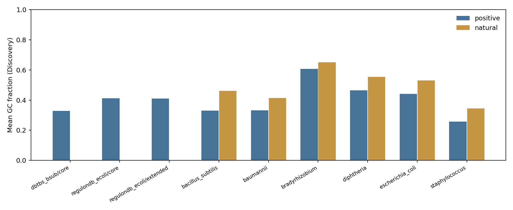

# M1/M2 课程数据统计补充

统一读取冻结v2，补充三来源、六物种及来源标签分组的数量、GC/长度、两个固定字符串的出现位置与间距。仅为课程数据分析，无模型训练或新候选发现。

| 来源/层级 | 正类 | 天然负类 | 同源组 |
| --- | ---: | ---: | ---: |
| dbtbs_bsub/core | 432 | 0 | 426 |
| regulondb_ecoli/core | 1793 | 0 | 1716 |
| regulondb_ecoli/extended | 2020 | 0 | 1810 |
| tjupan_bacillus_subtilis/main | 691 | 809 | 1487 |
| tjupan_baumannii/main | 1540 | 1360 | 2474 |
| tjupan_bradyrhizobium/main | 1983 | 1952 | 3880 |
| tjupan_diphtheria/main | 1653 | 1655 | 3188 |
| tjupan_escherichia_coli/main | 1635 | 1703 | 3234 |
| tjupan_staphylococcus/main | 2206 | 1162 | 2835 |

所有纳入序列均为81 bp，TSS局部第61位。来源与层级不合并计独立样本；RegulonDB extended单列，DBTBS与TJU的跨来源重叠保留。天然正负类组成差异按实际值展示。

模板仅在转录正向输入直接匹配TATAAT与TTGACA，分别报告exact与≤1错配；位点起点相对TSS为start0−60。预先固定的宽描述区间为TATAAT起点[−15,−6]、TTGACA起点[−40,−29]，仅用作统一描述字段；TJU缺逐条sigma标签，其他sigma组不据此解释为适用结构。

间距表同时保留未过滤共现、全部组合数及重叠/反序组合数；每序列只选一个不重叠、顺序正确的组合。优先两个描述窗口内的起点，其次距离−35/−12起点的绝对差总和，再按左端坐标。gap=start10−start35−6，不临时按gap大小删值。

全部split只做数量、长度与GC质检；模板位置/间距仅用Discovery和Development，没有新增Holdout模型评价。每来源标签多对多关系保留，single分组只纳入恰有一个不同sigma标签的序列。旧组员表的过滤定义不完全相同，本补充单独保存且不覆盖旧表，最终展示采用这里统一定义的表格。

完整表：[数量](m1_source_inventory.tsv)、[标签覆盖](m1_sigma_coverage.tsv)、[GC/长度](m2_gc_length.tsv)、[固定模板命中](m2_known_element_hits.tsv)、[位置](m2_tss_position.tsv)、[间距](m2_pair_spacing.tsv)、[核验](audit.json)。
